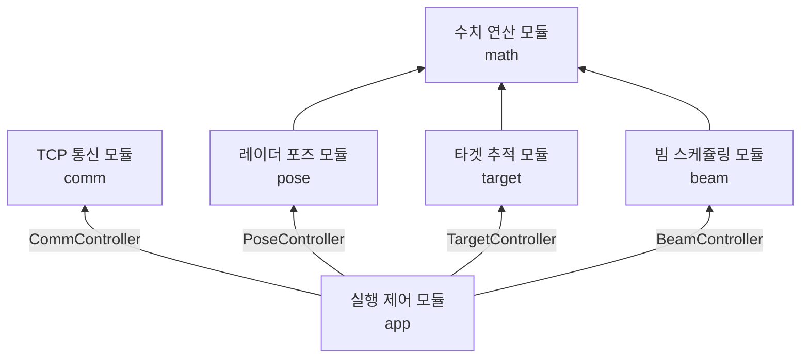
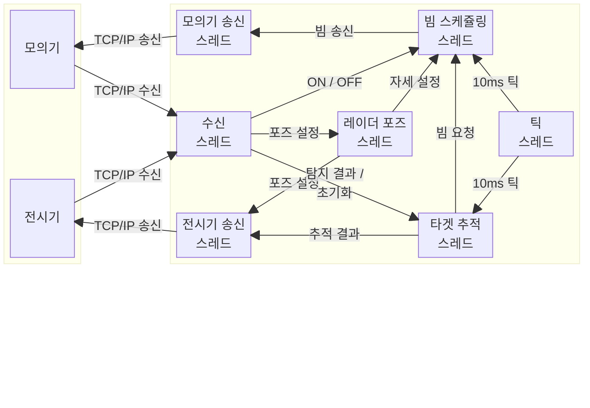

# AESA 추적 레이더 데이터 처리부

모의기로부터 받은 **빔 탐지 결과**를 바탕으로 타겟을 추적하고, 탐색 및 추적에 필요한 **빔 송신 명령**을 모의기로 전달합니다. **타겟 추적 결과**는 전시기로 전달합니다.

## 기여자

| 이름 | 주요 역할 |
|---|---|
| [신성현](https://github.com/sin6708k) | • 시스템 내부 구조 설계<br/>• 각 모듈 코드 리뷰 및 리팩터링<br/>• 수치 연산(`math`) 모듈 구현 |
| [박현준](https://github.com/2chasik) | • 타겟 추적(`target`) 모듈 구현 |
| [이인성](https://github.com/inseong10) | • TCP 통신(`comm`) 모듈 구현 |
| [장해찬](https://github.com/papperfield) | • 실행 제어(`app`) 모듈 구현 |
| [천영기](https://github.com/YGC20) | • 빔 스케쥴링(`beam`) 모듈 구현 |

## 시스템 구성도

### 모듈 구조



### 스레드 통신 구조



## 빌드 및 실행

### Linux

#### 1. 개발 도구를 준비합니다

GCC, Clang, CMake를 설치합니다.

```sh
sudo apt-get update
sudo apt-get install -y cmake build-essential clang
```

#### 2. 저장소 루트로 이동합니다

```sh
cd /path/to/aesa-processor
```

#### 3. 환경 설정 파일을 만들고 수정합니다

모든 설정값은 **필수**입니다.

```sh
cp .env.example .env
```

#### 4. 애플리케이션을 빌드합니다

```sh
cmake -S . -B build -DCMAKE_BUILD_TYPE=Release -DBUILD_TESTING=OFF
cmake --build build --target app --parallel
```

#### 5. 애플리케이션을 실행합니다

```sh
./build/src/app/adp
```

### Windows PowerShell

#### 1. 개발 도구를 준비합니다

CMake, Ninja, Visual Studio C++ 도구 모음을 설치합니다.

```powershell
winget install --id Kitware.CMake --exact --source winget
winget install --id Ninja-build.Ninja --exact --source winget
winget install --id Microsoft.VisualStudio.2022.BuildTools --exact --source winget --override "--wait --passive --add Microsoft.VisualStudio.Workload.VCTools --includeRecommended"
```

설치가 끝나면 Visual Studio Developer PowerShell을 새로 열어 다음 단계를 진행합니다.

#### 2. 저장소 루트로 이동합니다

```powershell
cd "C:\path\to\aesa-processor"
```

#### 3. 환경 설정 파일을 만들고 수정합니다

모든 설정값은 **필수**입니다.

```powershell
Copy-Item .env.example .env
```

#### 4. 애플리케이션을 빌드합니다

```powershell
cmake --preset windows-ninja -DBUILD_TESTING=OFF
cmake --build --preset windows-release --target app
```

#### 5. 애플리케이션을 실행합니다

```powershell
.\build\src\app\adp.exe
```

## 테스트 실행

### Linux

#### 1. 개발 도구를 준비합니다

GCC, Clang, CMake를 설치합니다.

```sh
sudo apt-get update
sudo apt-get install -y build-essential clang cmake
```

#### 2. GoogleTest를 설치합니다

```sh
sudo apt-get install -y libgtest-dev
```

#### 3. 저장소 루트로 이동합니다

```sh
cd /path/to/aesa-processor
```

#### 4. 테스트 빌드를 구성합니다

```sh
cmake -S . -B build -DCMAKE_BUILD_TYPE=Debug -DBUILD_TESTING=ON
```

#### 5. 테스트를 빌드합니다

```sh
cmake --build build --parallel
```

#### 6. 테스트를 실행합니다

```sh
ctest --test-dir build --output-on-failure
```

### Windows PowerShell

#### 1. 개발 도구를 준비합니다

Visual Studio C++ 도구 모음, CMake, Ninja를 설치합니다.

```powershell
winget install --id Kitware.CMake --exact --source winget
winget install --id Ninja-build.Ninja --exact --source winget
winget install --id Microsoft.VisualStudio.2022.BuildTools --exact --source winget --override "--wait --passive --add Microsoft.VisualStudio.Workload.VCTools --includeRecommended"
```

설치가 끝나면 Visual Studio Developer PowerShell을 새로 열어 다음 단계를 진행합니다.

#### 2. GoogleTest를 설치합니다

```powershell
git clone https://github.com/microsoft/vcpkg "$env:USERPROFILE\vcpkg"
& "$env:USERPROFILE\vcpkg\bootstrap-vcpkg.bat"
$env:VCPKG_ROOT = "$env:USERPROFILE\vcpkg"
& "$env:VCPKG_ROOT\vcpkg.exe" install gtest:x64-windows
```

#### 3. 저장소 루트로 이동합니다

```powershell
cd "C:\path\to\aesa-processor"
```

#### 4. 테스트 빌드를 구성합니다

```powershell
cmake --preset windows-ninja -DBUILD_TESTING=ON "-DCMAKE_TOOLCHAIN_FILE=$env:VCPKG_ROOT/scripts/buildsystems/vcpkg.cmake"
```

#### 5. 테스트를 빌드합니다

```powershell
cmake --build --preset windows-release
```

#### 6. 테스트를 실행합니다

```powershell
ctest --preset windows-release
```
