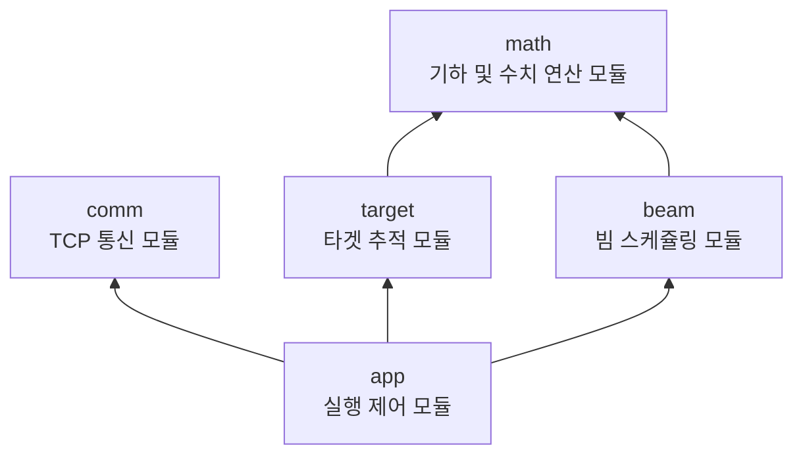

# aesa-processor

AESA 추적 레이더 데이터 처리부

## 기여자

| 이름 | 주요 역할 |
|---|---|
| [신성현](https://github.com/sin6708k) | • 시스템 내부 구조 설계<br>• 각 모듈 코드 리뷰 및 리팩터링<br>• `math`(기하 및 수치 연산) 모듈 구현 |
| [박현준](https://github.com/2chasik) | • `target`(타겟 추적) 모듈 구현 |
| [이인성](https://github.com/inseong10) | • `comm`(TCP 통신) 모듈 구현 |
| [장해찬](https://github.com/papperfield) | • `app`(실행 제어) 모듈 구현 |
| [천영기](https://github.com/YGC20) | • `beam`(빔 스케쥴링) 모듈 구현 |

## 시스템 내부 모듈 구조



- **외부 시스템과 통신 방식**: TCP/IP
- **내부 모듈 간 통신 방식**: 이벤트 큐

## 환경설정

- 실행 파일은 현재 작업 디렉터리의 `.env` 파일로부터 설정을 읽습니다.
- 모든 설정값은 필수입니다. 설정 파일이 없거나 설정값이 유효하지 않은 경우 애플리케이션은 워커 쓰레드를 시작하기 전에 오류를 출력하고 종료합니다.
- 저장소의 `.env.example` 파일을 복사한 뒤 운용 환경에 맞게 값을 변경해서 사용합니다.

```sh
cp .env.example .env
```
