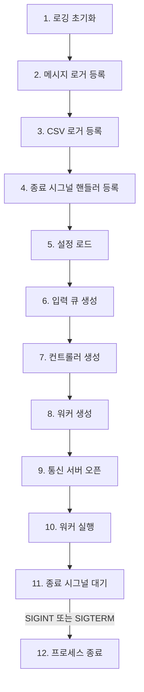
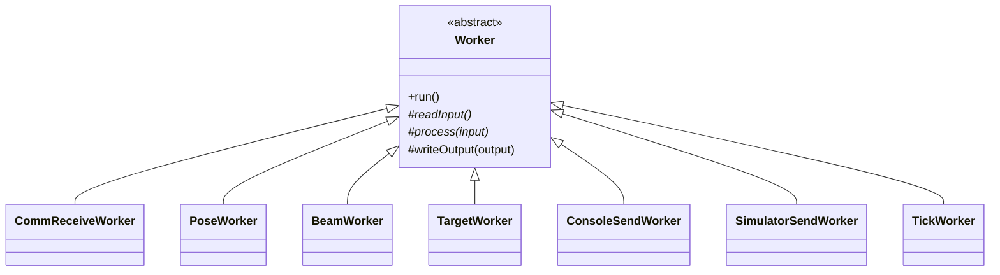

# 실행 제어(`app`) 모듈

## 디렉터리 구조

```text
app/
├── include/
│   └── app/                 # .gitkeep만 있음
├── src/
│   ├── config/
│   ├── dto/
│   ├── log/
│   │   ├── logger/          # 모듈 이벤트를 로그 형식으로 변환
│   │   └── support/         # 공용 보조 코드
│   ├── operation/           # 운용 상태 전환 판정
│   ├── queue/               # 스레드 간 메시지 전달 큐
│   ├── worker/              # 컨트롤러 호출과 워커 입출력 처리
│   └── main.cpp             # 실행 진입점
└── test/
    ├── unit/                # 단위 테스트
    │   ├── operation/
    │   └── queue/
    └── integration/         # 통합 테스트
        └── worker/
```

## 실행 흐름



## 워커 클래스 구성


