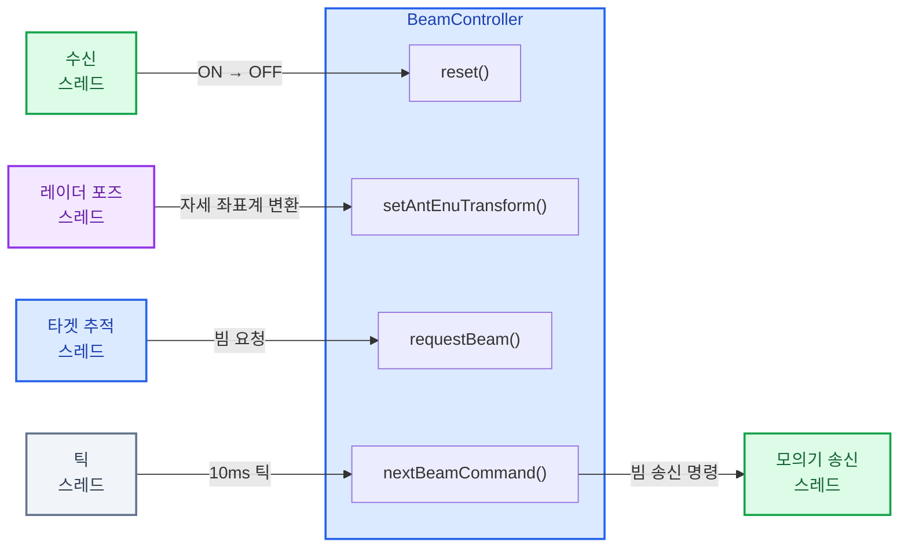
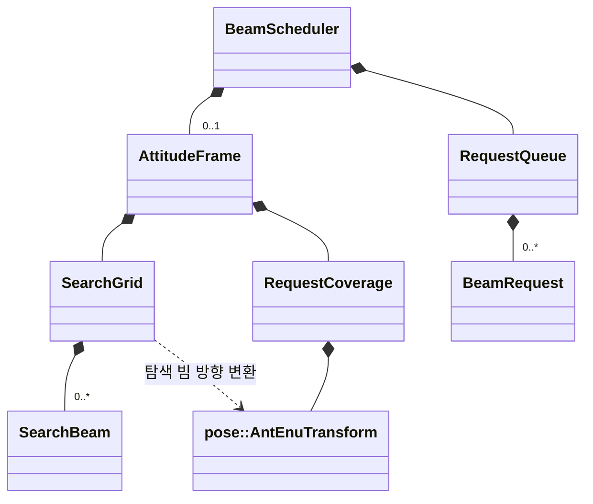

# 빔 스케줄링(`beam`) 모듈

## 디렉터리 구조

```text
beam/
├── include/
│   └── beam/
│       ├── config/
│       ├── controller/      # 모듈 호출 진입점
│       ├── domain/          # 도메인 모델과 규칙
│       └── dto/
│           └── log/
├── src/
│   └── domain/
│       ├── request/         # 요청 빔 데이터와 대기열, 영역 판정
│       │   └── factory/
│       ├── scheduler/       # 자세 프레임과 송신 순서 관리
│       └── search/          # 탐색 빔 격자와 순회 상태
└── test/
    ├── unit/                # 단위 테스트
    │   ├── config/
    │   ├── domain/
    │   │   └── request/
    │   │       └── factory/
    │   └── dto/
    ├── integration/         # 통합 테스트
    │   ├── controller/
    │   └── domain/
    │       ├── request/
    │       ├── scheduler/
    │       └── search/
    ├── scenario/            # 테스트와 시각화 도구가 공유하는 시나리오
    └── tools/               # 데이터 출력과 시각화
```

## 데이터 흐름



## 도메인 클래스 구성



## 환경 설정

| 환경 변수 | 설정 용도 | 허용 범위 |
|---|---|---|
| `BEAM_SEARCH_AZIMUTH_COUNT` | 탐색 격자의 방위각 개수 | 1 이상 |
| `BEAM_SEARCH_ELEVATION_COUNT` | 탐색 격자의 고각 개수 | 1 이상 |
| `BEAM_SEARCH_AZIMUTH_START_DEG` | 탐색 격자 방위각 시작점 | 제한 없음 |
| `BEAM_SEARCH_AZIMUTH_STEP_DEG` | 방위각 인접 격자점 간 간격 | 제한 없음 |
| `BEAM_SEARCH_ELEVATION_START_DEG` | 탐색 격자 고각 시작점 | [-90°, 90°] |
| `BEAM_SEARCH_ELEVATION_STEP_DEG` | 고각 인접 격자점 간 간격 | 마지막 고각이 [-90°, 90°] |
| `BEAM_SEARCH_WIDTH_DEG` | 탐색 빔 폭 | 0° 초과 |
| `BEAM_CONFIRMATION_WIDTH_DEG` | 확인 빔 폭 | 0° 초과 |
| `BEAM_TRACKING_WIDTH_DEG` | 추적 빔 폭 | 0° 초과 |
| `BEAM_REQUEST_COVERAGE_AZIMUTH_MIN_DEG` | 요청 허용 방위각 시작 경계 | 두 경계 간 차이 0° 제외, 절댓값 ≤ 360° |
| `BEAM_REQUEST_COVERAGE_AZIMUTH_MAX_DEG` | 요청 허용 방위각 끝 경계 | 두 경계 간 차이 0° 제외, 절댓값 ≤ 360° |
| `BEAM_REQUEST_COVERAGE_ELEVATION_MIN_DEG` | 요청 허용 고각 하한 | [-90°, 90°); 하한 < 상한 |
| `BEAM_REQUEST_COVERAGE_ELEVATION_MAX_DEG` | 요청 허용 고각 상한 | (-90°, 90°]; 하한 < 상한 |
