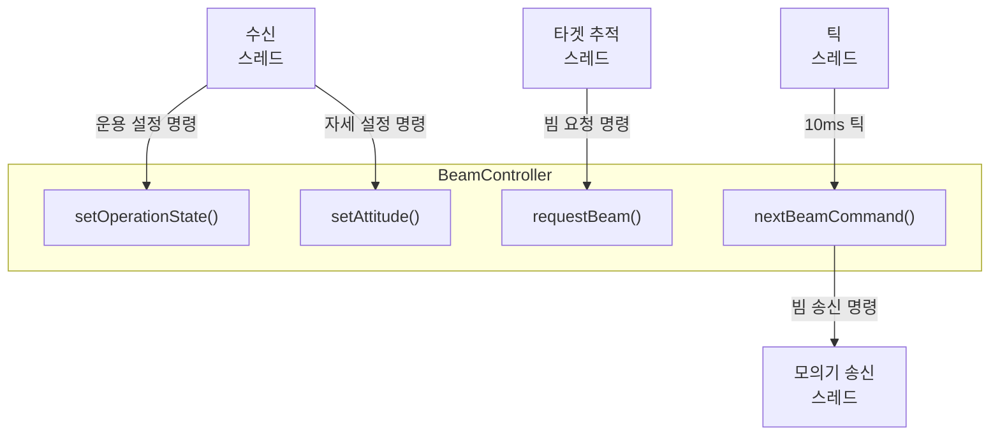
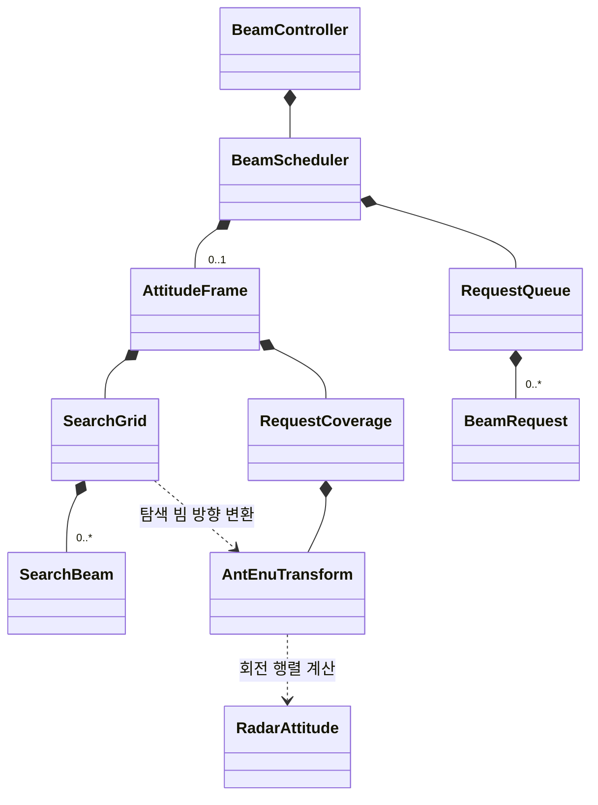

# 빔 스케줄링(`beam`) 모듈

## 입출력 인터페이스

## 클래스 다이어그램

## 환경 설정

| 환경 변수 | 설정 용도 | 허용 범위 |
|---|---|---|
| `BEAM_MAX_ABS_PITCH_DEG` | 허용하는 최대 절대 pitch | (0°, 90°] |
| `BEAM_MOUNT_ANT_TO_BODY_ROTATION` | 안테나 좌표계에서 몸체 좌표계로의 장착 회전 행렬 | 3×3 회전 행렬 |
| `MOUNT_ORTHOGONAL_ABSOLUTE_TOLERANCE` | 장착 행렬 직교성 검사의 절대 허용오차 | 0 이상 |
| `MOUNT_ORTHOGONAL_RELATIVE_TOLERANCE` | 장착 행렬 직교성 검사의 상대 허용오차 | 0 이상 |
| `BEAM_SEARCH_AZIMUTH_COUNT` | 탐색 격자의 방위각 개수 | 1 이상 |
| `BEAM_SEARCH_ELEVATION_COUNT` | 탐색 격자의 고각 개수 | 1 이상 |
| `BEAM_SEARCH_AZIMUTH_START_DEG` | 탐색 격자 방위각 시작점 | 제한 없음 |
| `BEAM_SEARCH_AZIMUTH_STEP_DEG` | 방위각 인접 격자점 간 간격 | 제한 없음 |
| `BEAM_SEARCH_ELEVATION_START_DEG` | 탐색 격자 고각 시작점 | [-90°, 90°] |
| `BEAM_SEARCH_ELEVATION_STEP_DEG` | 고각 인접 격자점 간 간격 | 마지막 고각이 [-90°, 90°] |
| `BEAM_SEARCH_WIDTH_DEG` | 탐색 빔 폭 | 0° 초과 |
| `BEAM_CONFIRMATION_WIDTH_DEG` | 확인 빔 폭 | 0° 초과 |
| `BEAM_TRACKING_WIDTH_DEG` | 추적 빔 폭 | 0° 초과 |
| `BEAM_REQUEST_COVERAGE_AZIMUTH_MIN_DEG` | 요청 허용 방위각 시작 경계 | 두 경계 간 차이 0° 제외, 절댓값 ≤ 360° |
| `BEAM_REQUEST_COVERAGE_AZIMUTH_MAX_DEG` | 요청 허용 방위각 끝 경계 | 두 경계 간 차이 0° 제외, 절댓값 ≤ 360° |
| `BEAM_REQUEST_COVERAGE_ELEVATION_MIN_DEG` | 요청 허용 고각 하한 | [-90°, 90°); 하한 < 상한 |
| `BEAM_REQUEST_COVERAGE_ELEVATION_MAX_DEG` | 요청 허용 고각 상한 | (-90°, 90°]; 하한 < 상한 |
