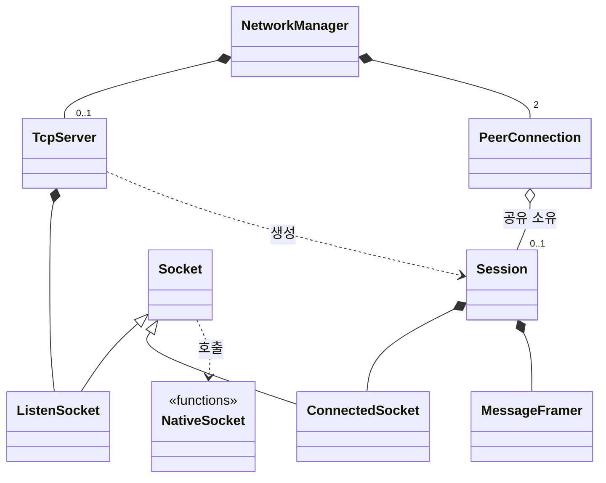

# TCP 통신(`comm`) 모듈

## 디렉터리 구조

```text
comm/
├── include/
│   └── comm/
│       ├── config/
│       ├── controller/      # 모듈 호출 진입점
│       ├── dto/
│       └── error/
├── src/
│   ├── message/             # 프레임 분리, 메시지 인코딩과 디코딩
│   │   └── dto/
│   ├── network/             # TCP 서버, 상대 연결, 세션 관리
│   │   ├── dto/
│   │   └── error/
│   ├── protocol/            # 전송 형식을 정의하는 메시지 구조체
│   └── socket/              # 소켓 핸들 관리와 플랫폼 API 래퍼
└── test/
    ├── unit/                # 단위 테스트
    │   ├── config/
    │   ├── message/
    │   └── socket/
    ├── integration/         # 통합 테스트
    │   └── socket/
    ├── support/             # 공용 보조 코드
    │   └── native_socket/
    ├── comm_main.cpp        # 수동 통신 테스트
    └── comm_sender.cpp      # 수동 송신 테스트
```

## 네트워크 클래스 구성



## 환경 설정

| 환경 변수 | 설정 용도 | 허용 범위 |
|---|---|---|
| `COMM_SERVER_ADDRESS` | 서버 바인딩 주소 | IPv4 주소 |
| `COMM_SERVER_PORT` | 서버 수신 대기 포트 | 1–65535 |
| `COMM_OPERATOR_CONSOLE_ADDRESS` | 전시기 연결의 출발지 주소 | IPv4 주소 |
| `COMM_OPERATOR_CONSOLE_PORT` | 전시기 연결의 출발지 포트 | 1–65535 |
| `COMM_SCENARIO_SIMULATOR_ADDRESS` | 모의기 연결의 출발지 주소 | IPv4 주소 |
| `COMM_SCENARIO_SIMULATOR_PORT` | 모의기 연결의 출발지 포트 | 1–65535 |
