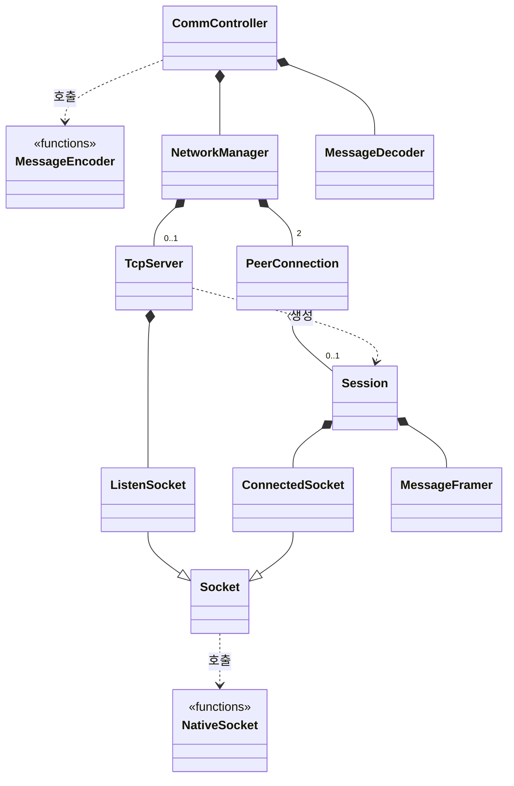

# TCP 통신(`comm`) 모듈

## 클래스 다이어그램

## 환경 설정

| 환경 변수 | 설정 용도 | 허용 범위 |
|---|---|---|
| `COMM_SERVER_ADDRESS` | 서버 바인딩 주소 | IPv4 주소 |
| `COMM_SERVER_PORT` | 서버 수신 대기 포트 | 1–65535 |
| `COMM_OPERATOR_CONSOLE_ADDRESS` | 전시기 연결의 출발지 주소 | IPv4 주소 |
| `COMM_OPERATOR_CONSOLE_PORT` | 전시기 연결의 출발지 포트 | 1–65535 |
| `COMM_SCENARIO_SIMULATOR_ADDRESS` | 모의기 연결의 출발지 주소 | IPv4 주소 |
| `COMM_SCENARIO_SIMULATOR_PORT` | 모의기 연결의 출발지 포트 | 1–65535 |
