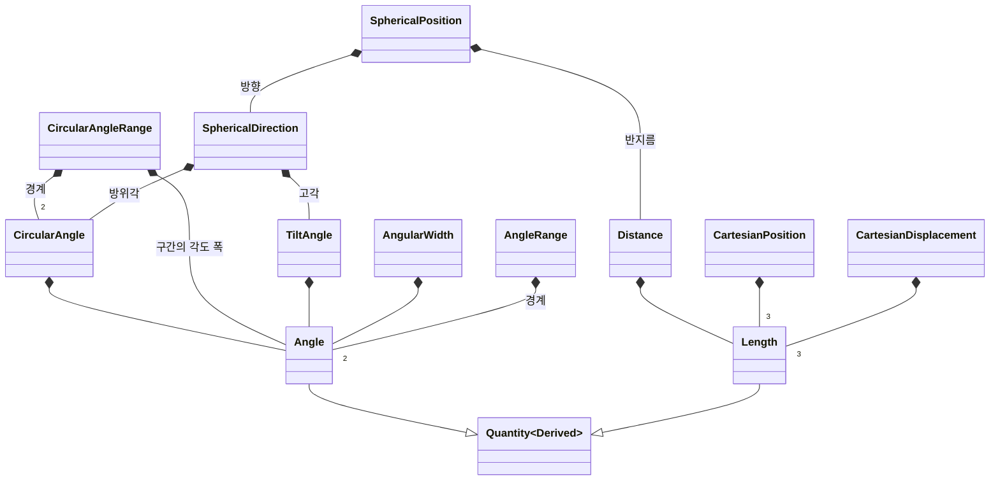
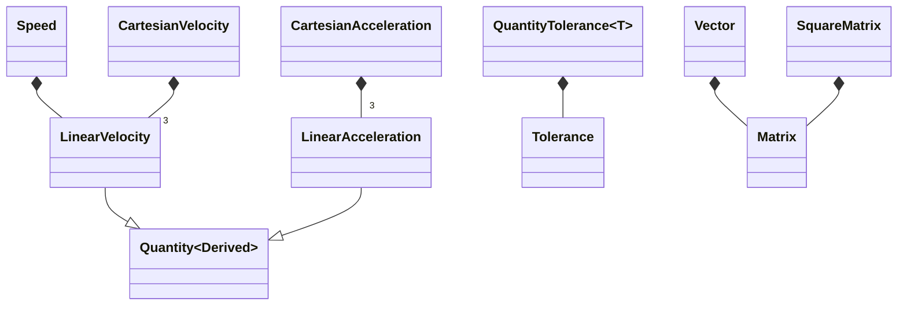

# 수치 연산(`math`) 모듈

## 클래스 다이어그램

## 주요 타입

| 타입 | 용도 | 단위 및 범위 |
|---|---|---|
| `Angle` | 각도 표현과 단위 변환 | 도, 라디안 |
| `Length` | 길이 표현과 단위 변환 | m, km |
| `LinearVelocity` | 선속도 표현 | m/s |
| `LinearAcceleration` | 선가속도 표현 | m/s² |
| `CircularAngle` | 한 바퀴를 주기로 하는 각도 표현 | [0°, 360°)로 정규화 |
| `TiltAngle` | 고각 등 기울기 표현 | [-90°, 90°] |
| `AngularWidth` | 각도 폭 표현 | 0° 초과 |
| `Distance` | 거리 표현 | 0 m 이상 |
| `Speed` | 속력 표현 | 0 m/s 이상 |
| `AngleRange` | 각도 구간의 포함 여부 검사 | 하한 < 상한, 양 끝 포함 |
| `CircularAngleRange` | 원형 각도 구간의 포함 여부 검사 | 시작점에서 각도가 증가하는 방향, 양 끝 포함 |
| `SphericalDirection` | 방위각과 고각으로 표현한 방향을 직교 단위벡터로 변환하거나 그 역을 계산 | 방위각 0°는 +y축, 90°는 +x축, 양의 고각은 +z축 방향 |
| `SphericalPosition` | 반지름과 방향으로 위치 표현 | 반지름 0 m 이상, 방향은 `SphericalDirection`의 좌표 규약을 따름 |
| `CartesianPosition` | 직교 좌표의 위치 표현과 구면 좌표 변환 | 각 성분 m |
| `CartesianDisplacement` | 직교 좌표의 변위 표현 | 각 성분 m |
| `CartesianVelocity` | 직교 좌표의 속도 표현 | 각 성분 m/s |
| `CartesianAcceleration` | 직교 좌표의 가속도 표현 | 각 성분 m/s² |
| `Vector` | 열벡터 연산 | N×1 |
| `Matrix` | 일반 행렬 연산 | M×N |
| `SquareMatrix` | 정방행렬 연산 | N×N |
| `Tolerance` | 수치의 절대 및 상대 허용오차 지정 | 두 값 모두 유한하며 0 이상 |
| `QuantityTolerance<T>` | 물리량의 절대 및 상대 허용오차 지정 | 절대오차는 물리량과 같은 단위, 상대오차는 무차원 |
