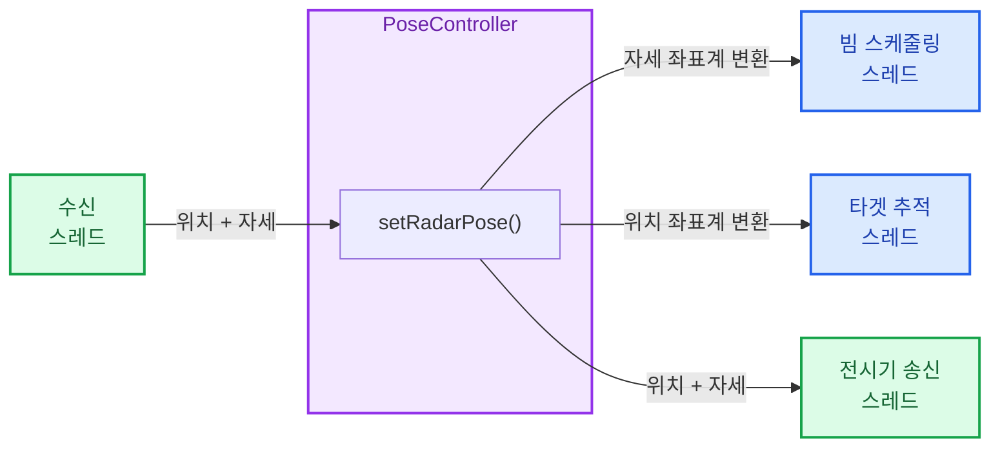
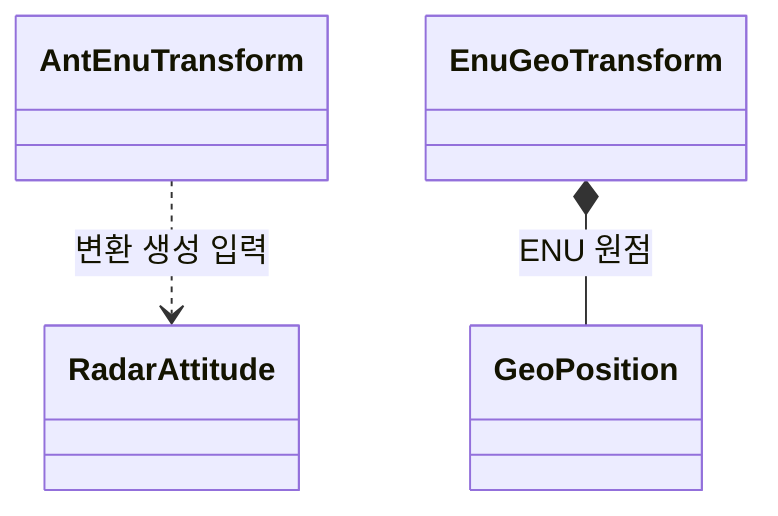

# 레이더 포즈 모듈(`pose`)

## 디렉터리 구조

```text
pose/
├── include/
│   └── pose/
│       ├── config/
│       ├── controller/      # 모듈 호출 진입점
│       ├── domain/          # 도메인 모델과 규칙
│       │   └── factory/
│       └── dto/
├── src/
└── test/
    ├── unit/                # 단위 테스트
    │   ├── config/
    │   └── domain/
    │       └── factory/
    └── integration/         # 통합 테스트
        └── controller/
```

## 데이터 흐름



## 도메인 클래스 구성



## 환경 설정

| 환경 변수 | 설정 용도 | 허용 범위 |
|---|---|---|
| `POSE_MAX_ABS_PITCH_DEG` | 절대 pitch의 상한 | (0°, 90°] |
| `POSE_MOUNT_ANT_TO_BODY_ROTATION` | 안테나 좌표계에서 몸체 좌표계로의 장착 회전 행렬 | 3×3 회전 행렬 |
