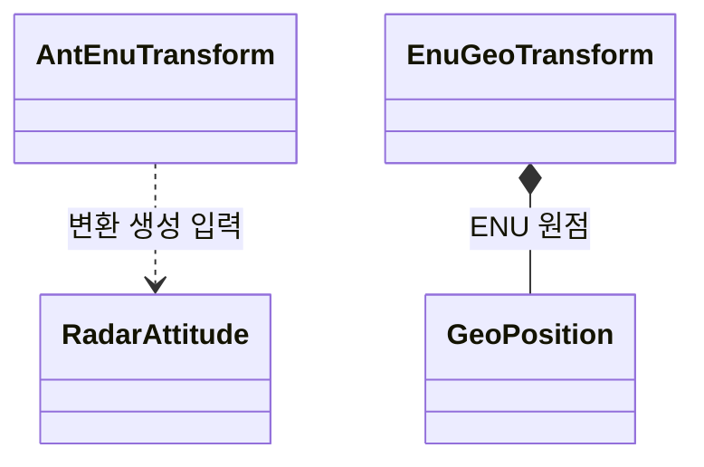

# 레이더 포즈 모듈(`pose`)

## 도메인 클래스 다이어그램

## 환경 설정

| 환경 변수 | 설정 용도 | 허용 범위 |
|---|---|---|
| `POSE_MAX_ABS_PITCH_DEG` | 절대 pitch의 상한 | (0°, 90°] |
| `POSE_MOUNT_ANT_TO_BODY_ROTATION` | 안테나 좌표계에서 몸체 좌표계로의 장착 회전 행렬 | 3×3 회전 행렬 |
