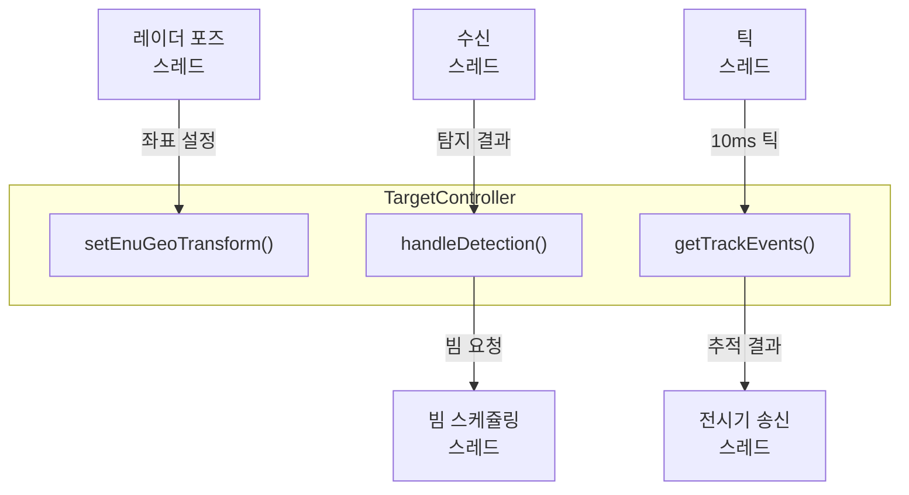
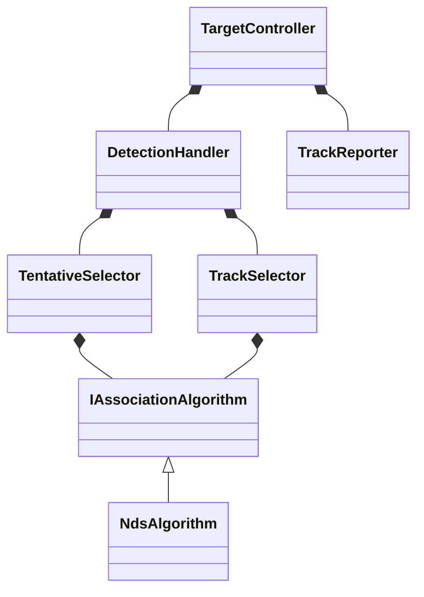
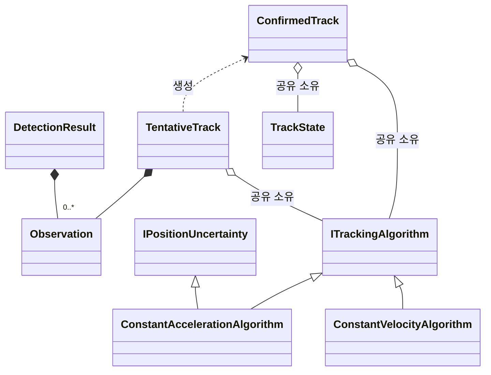
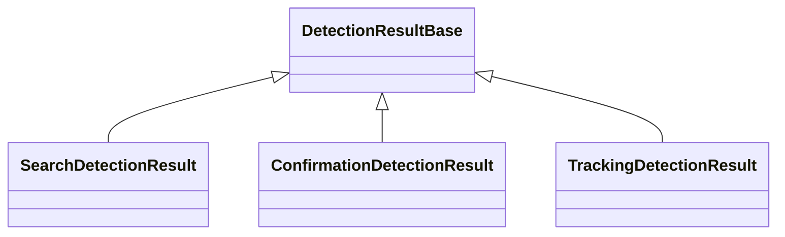

# 타겟 추적(`target`) 모듈

## 입출력 인터페이스

## 클래스 다이어그램

## 환경 설정

| 환경 변수 | 설정 용도 | 허용 범위 |
|---|---|---|
| `TARGET_MAX_ASSOCIATION_SPEED_MPS` | 관측과 기존 트랙을 연관할 때 허용하는 최대 속도 | 0 이상 |
| `TARGET_MAX_INITIAL_DOPPLER_DIFFERENCE_MPS` | 잠정 트랙 확인 시 허용하는 초기 도플러 속도 차이 | 0 이상 |
| `TARGET_MEASUREMENT_STANDARD_DEVIATION_M` | 위치 관측의 표준 편차 | 0 초과 |
| `TARGET_POSITION_NDS_THRESHOLD` | 위치 연관 NDS 점수 임계값 | 0 이상 |
| `TARGET_CONFIRMATION_DELAY_MS` | 확인 빔 요청까지의 지연 시간 | 0 ms 초과 |
| `TARGET_TRACKING_INTERVAL_MS` | 다음 추적 빔 요청까지의 간격 | 0 ms 초과 |
| `TARGET_MAX_CONSECUTIVE_TRACKING_MISSES` | 트랙을 유지할 최대 연속 미탐 수 | 1 이상 |
| `TARGET_INITIAL_ACCELERATION_STANDARD_DEVIATION_MPS2` | 초기 가속도 추정의 표준 편차 | 0 초과 |
| `TARGET_MAX_REPORTED_TRACK_COUNT` | 전시기에 보고할 최대 트랙 수 | 1–100 |
| `TARGET_PROCESS_ACCELERATION_STANDARD_DEVIATION_MPS2` | 추적 상태 예측에 사용하는 가속도 잡음 표준 편차 | 0 이상 |
