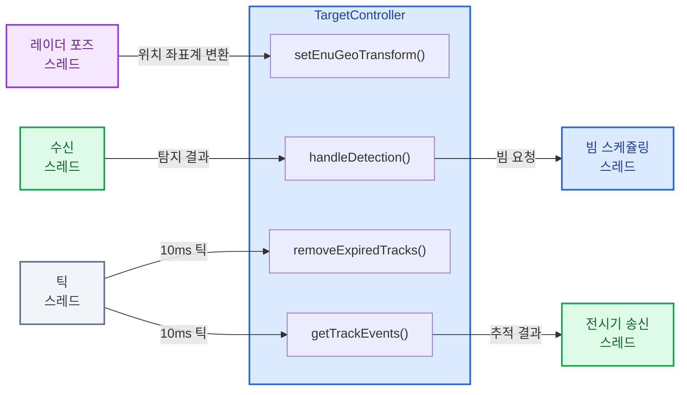
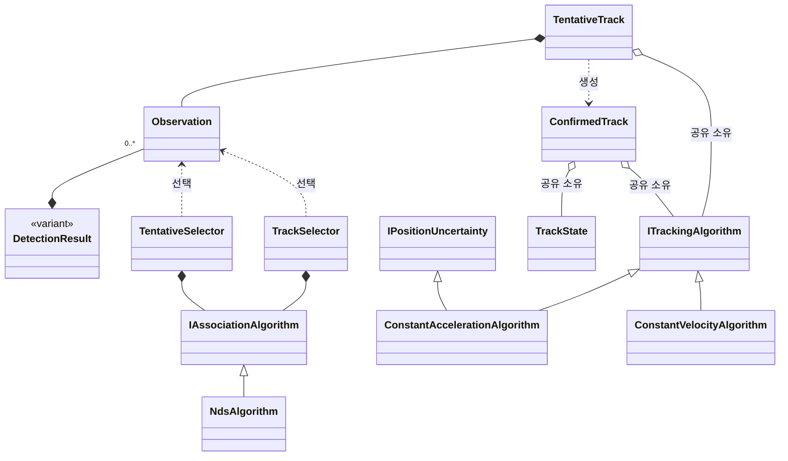
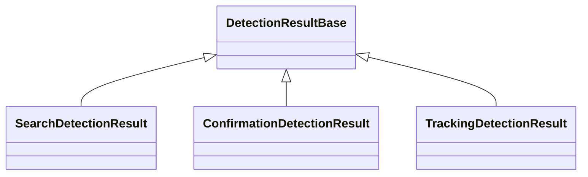

# 타겟 추적(`target`) 모듈

## 디렉터리 구조

```text
target/
├── include/
│   └── target/
│       ├── config/
│       ├── controller/      # 모듈 호출 진입점
│       └── dto/
│           └── log/
├── src/
│   ├── domain/              # 도메인 모델과 규칙
│   │   ├── association/     # 관측과 트랙의 연관 판정
│   │   ├── factory/
│   │   └── tracking/        # 트랙 상태 추정과 위치 불확실성 계산
│   ├── dto/
│   │   └── factory/
│   ├── repository/          # 도메인 객체의 저장과 조회
│   └── service/             # 도메인 동작을 조합하는 처리 흐름
└── test/
    ├── unit/                # 단위 테스트
    │   ├── domain/
    │   │   └── association/
    │   └── repository/
    ├── integration/         # 통합 테스트
    │   ├── config/
    │   ├── controller/
    │   ├── domain/
    │   │   ├── association/
    │   │   └── tracking/
    │   └── service/
    └── support/             # 공용 보조 코드
```

## 모듈 입출력 흐름



## 클래스 다이어그램





## 환경 설정

| 환경 변수 | 설정 용도 | 허용 범위 |
|---|---|---|
| `TARGET_MAX_ASSOCIATION_SPEED_MPS` | 관측과 기존 트랙을 연관할 때 허용하는 최대 속도 | 0 이상 |
| `TARGET_MAX_INITIAL_DOPPLER_DIFFERENCE_MPS` | 잠정 트랙 확인 시 허용하는 초기 도플러 속도 차이 | 0 이상 |
| `TARGET_MEASUREMENT_STANDARD_DEVIATION_M` | 위치 관측의 표준 편차 | 0 초과 |
| `TARGET_POSITION_NDS_THRESHOLD` | 위치 연관 NDS 점수 임계값 | 0 이상 |
| `TARGET_CONFIRMATION_DELAY_MS` | 확인 빔 요청까지의 지연 시간 | 0 ms 초과 |
| `TARGET_TRACKING_INTERVAL_MS` | 다음 추적 빔 요청까지의 간격. 연속 미탐 한도와 곱해 응답 대기 한도로도 사용 | 0 ms 초과 |
| `TARGET_MAX_CONSECUTIVE_TRACKING_MISSES` | 트랙을 유지할 최대 연속 미탐 수. 추적 주기와 곱해 응답 대기 한도로도 사용 | 1 이상 |
| `TARGET_INITIAL_ACCELERATION_STANDARD_DEVIATION_MPS2` | 초기 가속도 추정의 표준 편차 | 0 초과 |
| `TARGET_MAX_REPORTED_TRACK_COUNT` | 전시기에 보고할 최대 트랙 수 | 1–100 |
| `TARGET_PROCESS_ACCELERATION_STANDARD_DEVIATION_MPS2` | 추적 상태 예측에 사용하는 가속도 잡음 표준 편차 | 0 이상 |
