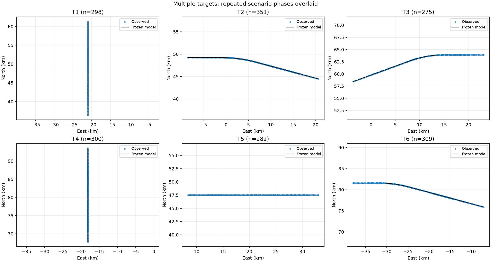
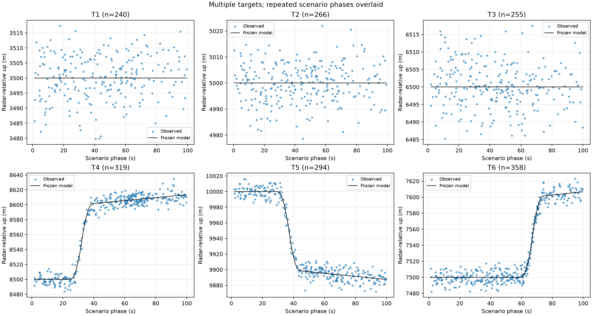
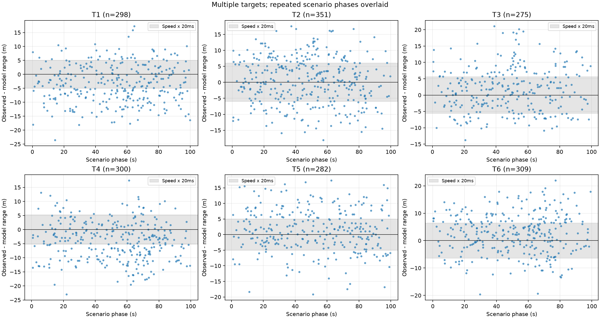
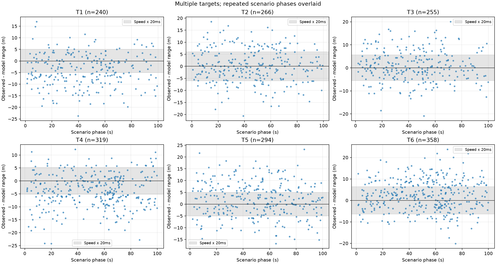
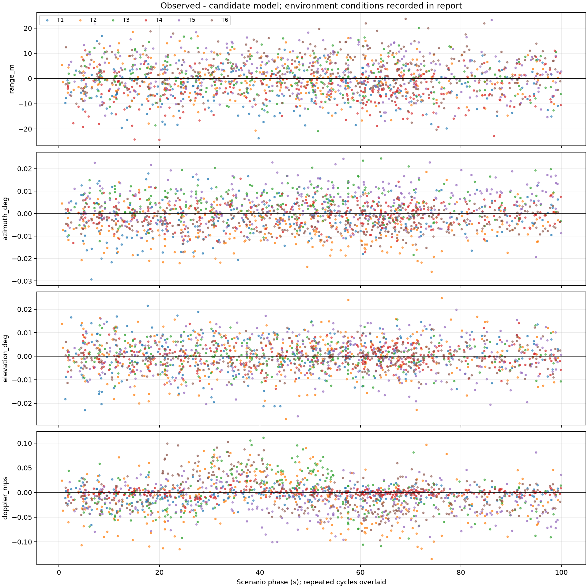

# 완만한 6표적 시나리오 검증

2026-11-17 (Asia/Seoul). **검증한 조건 안에서 비교용 기준 궤적으로 조건부 사용 가능. 원래 전체 완료 기준은 미충족.**

기존 운동 계수와 시계를 고정한 두 운용 구간에서 6개 표적 모두 플롯과 가까이 맞았다. 거리 잔차 RMS는 표적·구간별 6.771~8.012m, 최대 절대 잔차는 18.058~24.273m다. 두 구간의 전체 플롯은 3547개다. 이 수치는 수신 플롯−ini 계산값이며, 처리부 추정 트랙의 정확도나 참 위치에 대한 절대 오차의 상한을 뜻하지 않는다.

사전에 정한 참고값(거리 RMS≤10m, 최대≤30m, 거리 OLS 기울기 절대값≤0.1m/s, 방위·고각 RMS≤0.02도, 도플러 RMS≤0.5m/s)은 6표적×2구간에서 모두 만족했다. 반면 원래의 초기 직진 최대 오차≤속력×20ms 기준은 모든 표적에서 초과했다. 따라서 수 m 산포를 고려하는 궤적 비교에는 사용할 수 있지만, 수 m 이하 오차나 원래 완료 기준의 충족을 전제하는 확정 정답으로 인증한 것은 아니다.

## 시나리오와 고정 모델

- 시나리오: `scenarios/multi_target_moderate_6_in_view.ini` (513 bytes, CR 39개, LF 0개).
- SHA-256: `6941d75422372067c56259a1e15c0f461ebe3cc3dfaec65e87d98345c80023d9`.
- 모델: `multi_target_moderate_frozen_candidate.json`. 새 로그에 운동 계수·시계·반복 주기를 맞추지 않았다.
- 옵션 파일 SHA-256: `85574a4db17a3dc0ea528660fcf3e7fbef464fdd2b7dfd8302350ca7b8397075`.
- 순간 속력 결합 회전, 기동 사이 기준각 유지, TARGET 초기 속력으로 공칭 시간 계산, 0.1초 종료 올림, 이산 삼각 수직 갱신을 사용했다.
- 최초 가속도 방향은 진입 heading이다. 0·90·270도만 시험했으며 105도 등의 초기화 문제를 해결한 결과가 아니다.
- 시간 원점 0.01064606871776001초, 반복 주기 100.09847024568614초를 이전 단일 실험에서 가져와 두 구간에 그대로 적용했다.
- 모든 표적의 시작 지연 0초, 종료값 100초. 레이더 위치·자세·RCS 추정 필드는 원래 단일 파일에서 유지했다.

| 표적 | 초기 거리 km / 방위 도 / 고도 m | 속력 m/s / heading 도 | 기동 |
| --- | --- | --- | --- |
| 1 | 42 / −30 / 3500 | 250 / 0 | 직진 |
| 2 | 50 / −10 / 5000 | 300 / 90 | 25초 우선회 0.3g, 15도 |
| 3 | 68 / 20 / 6500 | 280 / 270 | 30초 좌선회 0.4g, 20도 |
| 4 | 70 / −15 / 8500 | 260 / 0 | 25초 상승 0.2g, 100m에 해당하는 ft 값 |
| 5 | 58 / 35 / 10000 | 250 / 270 | 30초 하강 0.2g, 100m에 해당하는 ft 값 |
| 6 | 90 / −25 / 7500 | 320 / 90 | 20초 우선회 0.4g, 15도 → 60초 상승 0.2g, 100m |

계획과 참고값은 잔차를 보기 전에 [multi_target_moderate_plan.md](multi_target_moderate_plan.md)에 기록했다. 첫 예비 파일에서는 T6 방위가 −35도여서 초기 관측이 없었다. 예비 구간을 별도 보존하고 T6 방위만 −25도로 옮겼다. 수정 시점에는 예비 자료의 운동 잔차를 확인하거나 보정하지 않았다. 수정 후 모델 경로의 표적 간 간격은 0.499초 격자에서 최소 약 3646m였다. 이 간격은 설계 계산값이다.

## 실행과 원본 보존

Computer Use로 GUI를 조작했다. Jammer·Clutter 목록 없음, 고정 Noise 체크+값 0을 전송하고 완료를 확인했다. 값 오른쪽 표시 단위는 GHz이며 측정 위치 오차를 없애는 입력이라고 확정하지 않는다. 전시기 Start → 모의기 모의 시작 순으로 실행했고 각 구간 중 ini를 다시 불러오지 않았다. 두 번째에도 같은 ini를 유지했다. 시나리오 자동 반복은 같은 구간 안의 반복 위상으로 처리했다.

원본 CSV: `C:\Users\user\Desktop\AESA 실행파일\데이터 처리부\logs\adp_detection_20261117_004955_840.csv`.
메시지 로그: 같은 폴더의 `adp_20261117_004955_837.log`.
두 구간은 같은 처리부 프로세스에서 운용을 정지·재시작한 자료다. 프로그램 전체를 재시작한 독립 2회 시험으로 세지 않는다.

| 항목 | 구간 1 | 구간 2 |
| --- | --- | --- |
| 원본 사본 폴더 | `tools/eval/data/gui_multi_moderate_1/` | `tools/eval/data/gui_multi_moderate_2/` |
| 선택 처리부 시각 ms | 4913666~5090487 | 5208484~5377770 |
| 기록 폭 s | 176.821 | 169.286 |
| 이벤트 / 빈 이벤트 / 플롯 | 11313 / 9628 / 1815 | 10811 / 9210 / 1732 |
| 연속 조각 / 모호·미대응·비활성 행 | 12 / 모두 0 | 12 / 모두 0 |
| CSV 사본 bytes | 2430851 | 2862345 |
| CSV SHA-256 | `c8ef8e0834bbcddeb361b66f410a30cedaf08643b434b45a168d851bebf8d4e4` | `82ea6120086d35351713779009d0804e871cd53c4b1f82ee622d6f60639faea9` |
| 운용 ON/OFF (11월 16일 UTC) | 17:11:34.197 / 17:14:46.332 | 17:16:24.698 / 17:19:33.615 |

원본 사본은 Git에서 제외했다. 각 폴더의 `scenario.ini`, `processor.log`, `metadata.json`에 입력과 해시가 있다. 예비 원본은 `tools/eval/data/gui_multi_moderate_pilot/`에 별도로 보존했다.

플롯의 위치·시간 연속성으로 먼저 12개 조각을 만들고, 고도가 분리된 경로와 초기 위치·반복 경계를 확인해 TARGET_1~6에 대응시켰다. 대응은 `multi_target_moderate_1_mapping.json`, `multi_target_moderate_2_mapping.json`에 있다. requestId나 전시기의 track ID를 정답 ID로 쓰지 않았다. 모호·미대응 0개가 절대적인 ID 확인이나 허위 플롯 부재의 증명은 아니다. 반복 경계를 제외한 표적별 최대 관측 간격은 두 구간 전체에서 1.029초 이하였다. 전시기의 추정 트랙 수를 검증 성공 판정에 사용하지 않았다.

## 표적별 전체 잔차

잔차는 관측−계산이다. 반복 주기를 겹쳐 집계하며 표본을 독립 실험 수로 해석하지 않는다. OLS 기울기는 추세의 기술 통계이며 통계적으로 무추세를 확정하는 검정은 아니다.

### 구간 1

| 표적 | n | 거리 RMS / 최대 m | 방위 RMS 도 | 고각 RMS 도 | 도플러 RMS m/s | 거리 기울기 m/s |
| --- | --- | --- | --- | --- | --- | --- |
| 1 | 298 | 7.645 / 23.550 | 0.00747 | 0.00774 | 0.0131 | +0.01267 |
| 2 | 351 | 7.188 / 18.058 | 0.00998 | 0.00797 | 0.0491 | -0.02717 |
| 3 | 275 | 6.977 / 21.125 | 0.00737 | 0.00624 | 0.0383 | +0.01608 |
| 4 | 300 | 7.923 / 23.034 | 0.00503 | 0.00480 | 0.0070 | -0.02516 |
| 5 | 282 | 6.963 / 19.194 | 0.00875 | 0.00769 | 0.0356 | -0.02046 |
| 6 | 309 | 7.779 / 21.947 | 0.00576 | 0.00473 | 0.0341 | +0.00137 |

### 구간 2

| 표적 | n | 거리 RMS / 최대 m | 방위 RMS 도 | 고각 RMS 도 | 도플러 RMS m/s | 거리 기울기 m/s |
| --- | --- | --- | --- | --- | --- | --- |
| 1 | 240 | 8.012 / 23.679 | 0.00853 | 0.00842 | 0.0163 | -0.00021 |
| 2 | 266 | 6.921 / 20.585 | 0.00970 | 0.00858 | 0.0487 | -0.01400 |
| 3 | 255 | 6.771 / 20.861 | 0.00821 | 0.00565 | 0.0411 | -0.00867 |
| 4 | 319 | 7.595 / 24.273 | 0.00511 | 0.00464 | 0.0077 | +0.01260 |
| 5 | 294 | 7.650 / 23.237 | 0.00885 | 0.00799 | 0.0362 | -0.02305 |
| 6 | 358 | 7.673 / 23.777 | 0.00572 | 0.00490 | 0.0350 | +0.00824 |

## 기동 중 잔차

모델에서 기동이 활성인 표본의 통계다. 중간 종료·후속 기동을 포함한 전체 구간도 위에서 별도로 집계했으므로 종료 후 누적 오차를 배제하지 않았다.

| 구간 / 표적 / 종류 | n | 거리 RMS / 최대 m | 방위 RMS 도 | 고각 RMS 도 | 도플러 RMS m/s |
| --- | --- | --- | --- | --- | --- |
| 1 / T2 / 4 | 109 | 7.581 / 17.597 | 0.01027 | 0.00779 | 0.0446 |
| 1 / T3 / 3 | 93 | 7.734 / 21.125 | 0.00765 | 0.00666 | 0.0468 |
| 1 / T4 / 1 | 39 | 6.116 / 13.416 | 0.00527 | 0.00527 | 0.0130 |
| 1 / T5 / 2 | 40 | 7.553 / 16.132 | 0.00846 | 0.00798 | 0.0386 |
| 1 / T6 / 1 | 76 | 7.938 / 19.371 | 0.00668 | 0.00500 | 0.0351 |
| 1 / T6 / 4 | 70 | 7.152 / 19.646 | 0.00529 | 0.00506 | 0.0449 |
| 2 / T2 / 4 | 86 | 6.695 / 20.585 | 0.00885 | 0.00801 | 0.0401 |
| 2 / T3 / 3 | 88 | 6.707 / 20.861 | 0.00808 | 0.00528 | 0.0473 |
| 2 / T4 / 1 | 39 | 6.816 / 16.627 | 0.00594 | 0.00538 | 0.0167 |
| 2 / T5 / 2 | 40 | 7.430 / 16.286 | 0.00817 | 0.00838 | 0.0401 |
| 2 / T6 / 1 | 85 | 8.352 / 23.777 | 0.00654 | 0.00471 | 0.0374 |
| 2 / T6 / 4 | 74 | 7.137 / 17.966 | 0.00628 | 0.00484 | 0.0508 |

## 원래 20ms 기준과 사용 범위

| 표적 | 속력×20ms 한계 m | 초기 직진 n (1/2) | 초기 최대 오차 m (1/2) | 원래 최대 오차 기준 |
| --- | --- | --- | --- | --- |
| 1 | 5.0 | 298 / 240 | 23.550 / 23.679 | 두 구간 모두 초과 |
| 2 | 6.0 | 80 / 70 | 13.605 / 18.575 | 두 구간 모두 초과 |
| 3 | 5.6 | 75 / 83 | 15.768 / 18.516 | 두 구간 모두 초과 |
| 4 | 5.2 | 61 / 71 | 23.034 / 24.273 | 두 구간 모두 초과 |
| 5 | 5.0 | 76 / 81 | 18.325 / 21.702 | 두 구간 모두 초과 |
| 6 | 6.4 | 43 / 52 | 14.035 / 18.761 | 두 구간 모두 초과 |

장시간 직진인 T1에서도 약 7~8m RMS의 산포가 남는다. 다른 표적에서도 모든 기동을 포함한 누적 오차가 이 정도 수준이지만, 이 관측만으로 산포 전부를 모의기 잡음이라고 단정하거나 계산 궤적의 절대 오차를 인증하지 않는다.

사용 가능한 범위는 검증한 시나리오와 같은 모델 조건에서 수 m 산포를 감안하는 궤적 비교다. 임의의 중간 heading, 원본 표적 3·9의 초기화, 더 큰 속력·가속도·선회각, 더 낮은 속력, 교차·근접 표적, 다른 상승·하강 크기로 확대 검증하지 않았다. 이 시나리오가 맞는다고 모든 ini에 적용 가능한 확정 정답이라는 뜻은 아니다. 계산기 출력의 `unverified_hypothesis`는 유지한다.

## 두 운용 구간 비교

같은 고정 옵션으로 공통 위상을 비교했다. 1.2초 이하 간격만 선형 보간해 3117쌍을 얻었다. 아래 차이에는 두 측정의 산포와 시간 정렬·보간 오차가 함께 들어 있다. 원본 선택 바이트는 동일하지 않으며 표본 수와 시각도 다르다. 완전 재시작 재현성은 확인하지 못했다.

| 표적 | 비교 쌍 | 거리 차 RMS m | 방위 차 RMS 도 | 고각 차 RMS 도 | 도플러 차 RMS m/s |
| --- | --- | --- | --- | --- | --- |
| 1 | 501 | 9.266 | 0.01011 | 0.00993 | 0.0184 |
| 2 | 619 | 9.234 | 0.01078 | 0.01083 | 0.0678 |
| 3 | 478 | 8.738 | 0.00816 | 0.00771 | 0.0955 |
| 4 | 517 | 8.846 | 0.00650 | 0.00658 | 0.0074 |
| 5 | 467 | 9.315 | 0.00995 | 0.01006 | 0.0394 |
| 6 | 535 | 9.498 | 0.00635 | 0.00624 | 0.0336 |

## 보조 시계 진단

정식 잔차를 보기 전에 예비 T1 직진 154개만으로 원점에 +0.011723648초를 더하는 보조 옵션을 만들었다. 정식 자료는 이 보정에 사용하지 않았다. 주기·물리 계수는 유지했고, 이 보조 결과를 위의 고정 시계 주 검증과 섞지 않았다. 보조 옵션의 표적별 거리 RMS는 1구간 6.743~7.387m, 2구간 6.546~7.413m다. 사용 가능 판단과 표는 시계까지 고정한 원래 결과를 기준으로 했다.

## 그림











## 사용과 재현

시나리오 위상 초를 직접 넣을 때는 `multi_target_moderate_phase_options.json`을 사용한다. 고정 물리 옵션은 같고 시간 원점만 0으로 옮긴 파일이다. 예를 들어 위상 10/35/75초의 표적 6 위치·속도를 계산한다.

```powershell
python -m tools.eval predict --ini tools/eval/scenarios/multi_target_moderate_6_in_view.ini --options tools/eval/multi_target_moderate_phase_options.json --target 6 --time 10 --time 35 --time 75
```

이 파일에서 `--time`은 0원점 시나리오 위상 입력이며 반복 주기는 위 후보값을 사용한다. 실제 처리부 CSV 시각과 비교하려면 해당 프로세스의 원점·주기를 별도로 정렬해야 한다. 처리부를 재시작하거나 다른 ini로 바꾸면 이번 고정 원점을 그대로 적용하지 않는다.

```powershell
$one = "tools/eval/data/gui_multi_moderate_1"
$two = "tools/eval/data/gui_multi_moderate_2"
python -m tools.eval.analyze --csv "$one/detections.csv" --ini "$one/scenario.ini" --mapping tools/eval/multi_target_moderate_1_mapping.json --options tools/eval/multi_target_moderate_frozen_candidate.json --start-ms 4913666 --end-ms 5090487 --output tools/eval/output/multi_moderate_1 --plots
python -m tools.eval.analyze --csv "$two/detections.csv" --ini "$two/scenario.ini" --mapping tools/eval/multi_target_moderate_2_mapping.json --options tools/eval/multi_target_moderate_frozen_candidate.json --start-ms 5208484 --end-ms 5377770 --output tools/eval/output/multi_moderate_2 --plots
python -m tools.eval.compare_runs --first tools/eval/output/multi_moderate_1 --second tools/eval/output/multi_moderate_2 --output tools/eval/output/multi_moderate_comparison
python -m tools.eval.plot_multitarget --analysis tools/eval/output/multi_moderate_1 --output tools/eval/output/multi_moderate_1
python -m tools.eval.plot_multitarget --analysis tools/eval/output/multi_moderate_2 --output tools/eval/output/multi_moderate_2
```

기동별 세부 표는 `residuals.csv`를 표적·`maneuver_active`별로 선택하고 기존 `statistics_for`로 계산했다. `validation_detail.json`에는 관측 간격과 사전에 정한 참고값 판정도 보관했다. 기존 분석 코드의 운동식은 이번 다중 표적 결과에 맞춰 변경하지 않았다. 새 코드는 저장한 분석 결과에서 다중 표적 그림을 만드는 `plot_multitarget.py`다.

Python 기존 단위 테스트 44개 통과. 새 다중 표적 ini 파싱·경로 계산, 두 구간 전체 잔차 계산, 공통 위상 비교와 그림 생성을 실제 수행했다. 그림은 눈으로 확인했다. C++ 소스 변경과 빌드·테스트는 없다.

위상 입력 옵션은 6개 표적×10/35/75초에서 처리부 시각 입력과 좌표·속도가 일치하는지 확인했고,
문서의 예측 CLI도 실제 실행했다. 원본 사본의 CSV·ini·메시지 로그 해시, 고정 옵션 해시와 두 구간의
동일 옵션 사용을 확인했다. 검증 종료 후 Noise 체크를 원래의 꺼짐·값 0으로 복원해 전송하고,
기존 `target_3_kind_2.ini`를 다시 전송했다. 프로그램은 켜 두고 전시기 Stop·모의기 모의 종료 상태로 남겼다.
