# 시나리오 궤적 계산 및 실제 플롯 검증 보고서

작성일: 2026-11-16, 단일 종류 1~4 추가 분석: 2026-11-17 (Asia/Seoul). **부분 검증 완료, 전체 완료 기준은 미충족.**

2026-11-17 추가 다중 표적 검증: 완만한 6표적 시나리오를 만들어 같은 모델·시계로 두 운용 구간을
측정했다. 새 자료에 계수를 맞추지 않아도 거리 잔차 RMS 6.771~8.012m, 전체 최대 24.273m로
가깝게 맞았다. 검증한 조건에서 수 m 산포를 고려하는 비교용 기준 궤적으로 조건부 사용할 수 있다.
원래 속력×20ms 기준은 초과했으며 임의의 ini에 대한 확정 정답으로 일반화하지 않는다.
시나리오·전체 수치·그림·사용법은 [6표적 검증 보고서](multi_target_moderate_report.md)에 있다.

## 결론과 검증 범위

사용자가 `Target_10_2.ini`, Jammer=0, Clutter=0, Noise=0으로 실행했다고 확인한 첫 수동 실험을 분석했다.
실제 플롯으로 초기 거리 km·지상거리, 레이더 기준 고도 m, 초기 속력 m/s,
표적별 시작 지연과 기동의 시나리오 기준 시작 시각을 지지하는 결과를 얻었다.
초기 직진 구간의 거리 잔차 RMS는 표적별 약 4~8m다. 표적 5~10은 속력×20ms 기준을 넘는다.
짧은 직진 구간의 추세도 충분히 배제하지 못했으므로 전체 직진 완료 기준을 통과했다고 선언하지 않는다.

기동 이후에는 특히 표적 3·9의 수평 운동 모델이 맞지 않는다. 기동 종류 1~4의 실제 잔차를 모두
아래에 제시하지만, 현재 계산기를 전체 시나리오의 확정 정답으로 쓰면 안 된다.
`manual_run_1_candidate.json`은 데이터에 맞춰 선택한 **후보**이며, 출력 상태도 계속 `unverified_hypothesis`다.
알고리즘 성능 평가나 추적 성능 지표는 계산하지 않았다.

추가 단일 종류 1 실험에서는 기존 연속시간 후보의 상승 종료 후 고도에 평균 +8.988m 편차가 남았다.
이후 종류 2의 지속 하강을 관측하여 0.1초 이산 가속도 갱신 후보를 추가했다. 이 후보는
종류 1·2 종료 후 고도 RMS를 각각 10.864→6.155m, 105.172→6.894m로 줄였다.
일부 거리·도플러 항목은 악화하므로 수직 운동 전체도 확정하지 않았다. 상세 결과는 각 실험 절에 있다.

단일 종류 4에서는 선회 후 관측 속력이 약 962.110m/s로 초기 850m/s보다 커졌다. 등속력 선회 가정이
맞지 않으며, 회전 가속도 후보로 선회 중 거리 RMS를 77.207m에서 7.393m로 줄였다. 종료 후에는
RMS 47.549m와 시간에 따른 추세가 남고 원본 전체에도 적용하지 못해 새 후보도 미확정이다.

이후 단일 종류 3에서는 선회 후 관측 속력이 약 644.688m/s로 줄었다. 종류 4에서 선택한 회전 가속도
규칙을 물리 옵션 재보정 없이 적용한 결과, 선회 중 거리 RMS 30.334m, 종료 후 1052.529m로 맞지 않았다.
따라서 좌우 선회의 공통 운동 모델을 확정하지 못했다. 단독 종류 1~4의 실제 로그와 잔차는 모두 확보했다.

이후 GUI 추가 실험에서 순간 속력과 가속도 방향의 회전을 결합한 후보가 단일 좌우 선회의 누적 오차를
크게 줄였다. 이전 후보의 실패 수치는 이력으로 유지한다. 새 후보도 표적 전체에 공통인 초기화 규칙을
확정하지 못했으므로 확정 정답으로 취급하지 않는다. 최신 수치는 보고서 뒤의 GUI 추가 실험 절에 있다.

처음에는 GUI 설정 때문에 요청의 중단 조건에 따라 1~2단계에서 멈췄다.
이후 사용자가 직접 실험을 실행하고 조건을 확인해 주어, 확보된 로그로 분석을 재개했다.
이후 사용자가 직접 UI 제어를 요청하여 에이전트가 이미 실행 중인 모의기·전시기를 조작한 추가 실험도
진행했다. 해당 구간은 아래에서 수동 실험과 구분한다. `src/`, `.env`, 원본 ini는 수정하지 않았다.

## 원본과 실험 구간

원본 시나리오: `C:\Users\user\Downloads\Target_10_2.ini`

- SHA-256: `3a7d3eb3c5a10ba98e6267639ed12385d42760a1f86c3ee9359342220c633b37`
- 원본 1552 bytes, CR 88개, LF 0개. 실제 파일에서 파싱한 표적은 10개이며 기동 종류 1~4가 있다.
- TARGET 필드 9는 표적 1~5에서 각각 4줄, 표적 6~10에서 각각 3줄로 실제 MANEUVER 줄 수와 일치한다.

분석에 사용한 CSV 원본:
`C:\Users\user\Documents\GitHub\aesa-processor\logs\adp_detection_20261116_211508_545.csv`

이 CSV에는 이전 실행도 섞여 있다. 최근 실험으로 선택한 처리부 시각은
**4,379,948~4,511,052ms**, 기록 시간 폭은 **131.104초**다.
메시지 로그에는 운용 ON `2026-11-16T13:28:01.436Z`(한국 시각 22:28:01.436),
OFF `13:30:21.367Z`가 남아 있다. 첫 수신 시각을 시나리오 운동 원점으로 사용하지 않았다.

원본 전체의 바이트 사본을 다음 Git 제외 디렉터리에 보관했다.

- CSV: `C:\Users\user\Documents\GitHub\aesa-processor\tools\eval\data\manual_20261116_2228\detections.csv`
- 메시지 로그: 같은 디렉터리의 `processor.log`
- ini 사본: 같은 디렉터리의 `scenario.ini`
- 입력 경로·해시·선택 구간·사용자 확인 조건: 같은 디렉터리의 `metadata.json`

CSV 스냅샷 SHA-256:
`aba610500e648e0d2ef0ac8de3850a7eb76d5e10c9162ef4e3e8006fbbf6e05b`
스냅샷 크기는 796001 bytes다. 원본 CSV는 이후 실행으로 더 커졌지만 이 사본은 변경하지 않았다.
원본 CSV와 실험 사본은 커밋하지 않으며, `tools/eval/data/`와 `output/`은 `.gitignore`로 제외한다.

## 플롯–표적 대응

선택 구간은 탐지 이벤트 8359개, 빈 탐지 이벤트 7039개, 실제 플롯 1397개다.
CSV 행 위치를 원본 스냅샷 기준으로 보존하며, 같은 빔의 여러 플롯은 하나의 이벤트로 묶는다.

ini 예측을 보기 전에 R/Az/El을 관측 직교 좌표로 바꾸어 일정 속도 외삽과 거리·시간 연속성으로 연결했다.
연결 간격 상한 6초, 속력 상한 2500m/s, 위치 여유 200m, 가속도 여유 120m/s²를 사용했다.
한 이벤트 내에는 연속 궤적 하나에 플롯 하나만 연결한다. 서로 경쟁하는 가까운 연결은 모호성으로 표시한다.
정답 후보에 가장 가깝게 되도록 매 시각 대응을 다시 고르지 않았다. 처리부 requestId를 표적 ID로 사용하지 않았다.

빔 미조사와 시나리오 반복 때문에 연속 궤적은 29개 조각으로 분리됐다. 초기 위치·고도·진행 방향과
반복 궤적의 연속성을 검토하여 `manual_run_1_mapping.json`에 TARGET 대응을 명시했다.
이 대응은 해당 실험의 수동 검토 결과이며 새 로그에 그대로 재사용하면 안 된다.
매칭 게이트에서 모호성으로 표시한 행과 대응하지 못한 행은 각각 0개다.
표적 ID가 로그에 없으므로 이 수치는 절대적인 ID 확인이나 허위 플롯 부재의 증명이 아니다.

| 표적 | 연속 궤적 번호 | 플롯 수 |
| --- | --- | --- |
| 1 | 4, 12, 19, 23, 26, 27, 28 | 93 |
| 2 | 2, 11, 13, 24, 25, 29 | 95 |
| 3 | 10, 14 | 162 |
| 4 | 9, 15 | 170 |
| 5 | 8, 16 | 158 |
| 6 | 6, 17 | 160 |
| 7 | 3, 18 | 157 |
| 8 | 5, 20 | 133 |
| 9 | 1, 21 | 129 |
| 10 | 7, 22 | 140 |

## 기본 단위·시간 보정

첫 기동 시작의 0.5초 전까지만 초기 직진으로 선택했다. 시작 지연 후 0.1초 이내도 제외했다.
총 113개 플롯으로 거리 배율, 경사/지상거리, 고도 배율/기준, 속력 배율,
heading 부호/기준각, 필드 6의 각도/상승률과 부호를 조합한 1536개 후보를 시도했다.
보정한 반복 주기가 양수인 1504개를 비교했고 나머지 32개는 기각했다.
각 후보에서 모든 표적에 공통인 위상 원점과 반복 주기를 선형 최소제곱으로 보정했다.
시간 선정을 위한 초기 위상 추정과 플롯 대응은 별도 검토 입력이다. 모든 가능한 모델을 탐색한 것은 아니다.

| 순위 | 거리 해석 | 고도 기준 | 필드 6 | 부호 | XYZ 성분 RMS(m) |
| --- | --- | --- | --- | --- | --- |
| 1 | ground | radar | angle | 1 | 6.434535 |
| 2 | ground | radar | rate | 1 | 8.727576 |
| 3 | ground | radar | rate | -1 | 9.012438 |
| 4 | ground | radar | angle | -1 | 13.366916 |
| 5 | slant | radar | angle | 1 | 141.784677 |
| 6 | slant | radar | rate | 1 | 141.904364 |

최선 후보의 직교 성분 RMS는 6.434535m다. 보정한 기준 위상 원점은 처리부 시각
4304.254527915초, 반복 주기는 100.100855427초다. 기준 원점은 반복 위상으로만 정해지며,
이를 처리부 시작·운용 ON·첫 빔 중 어떤 조작 시점이라고 확정하지 않는다.
또한 이 주기가 ini 필드 11 때문에 결정되는지, 별도 반복 설정/시간 양자화 때문인지는 확인하지 못했다.
모든 표적이 시나리오 위상 약 100초에 사라지고 각자의 시작 지연 뒤 다시 초기 위치로 나타나는 현상을 반영했다.

원점·주기는 첫 실험의 같은 표본으로 보정했다. 따라서 아래는 **내부 보정 후 잔차**이며 독립 재현성 검증이 아니다.
절대 북쪽과 안테나 기준의 구별도 남아 있다. 현재 자세는 롤·피치가 0이고 요가 일정하여
초기 방위·heading·관측을 함께 회전시키는 동등한 좌표 해석을 이 로그만으로 구별할 수 없다.

## 필드 정의와 확인 상태

‘플롯으로 확인함’은 이 시나리오의 관측 범위에서 해당 해석을 지지한다는 뜻이다.
필드 인과관계나 모든 값 범위까지 외부 모의기 소스로 증명한 것은 아니다.

| 블록/필드 | 현재 정의 또는 남은 추정 | 확인 상태 |
| --- | --- | --- |
| SCENARIO 1 | 표적 수 10, 파일 구조와 관측 궤적군 수가 일치 | 플롯으로 확인함 |
| SCENARIO 2 | 레이더 위도, 도 추정 | 확인하지 못함 |
| SCENARIO 3 | 레이더 경도, 도 추정 | 확인하지 못함 |
| SCENARIO 4 | 레이더 해발 고도, m 추정 | 확인하지 못함 |
| SCENARIO 5 | 롤 추정; 현재 값이 0이라 순서/부호 식별 불가 | 확인하지 못함 |
| SCENARIO 6 | 피치 추정; 현재 값이 0이라 순서/부호 식별 불가 | 확인하지 못함 |
| SCENARIO 7 | 요 추정; 절대 방위 기준과 분리 식별 불가 | 확인하지 못함 |
| TARGET 1 | 초기 지상거리, km. 평면 계산에서 경사거리 해석보다 잘 맞음 | 플롯으로 확인함 |
| TARGET 2 | 초기 방위, 도. 관측 방위와 같은 기준·회전 방향 | 플롯으로 확인함 |
| TARGET 2의 절대 기준 | 북쪽/안테나 기준 중 무엇인지는 분리 불가 | 확인하지 못함 |
| TARGET 3 | 레이더 기준 상대 고도, m | 플롯으로 확인함 |
| TARGET 4 | 초기 속력, m/s. 기동 중에도 일정하다는 뜻은 아님 | 플롯으로 확인함 |
| TARGET 5 | 초기 heading, 도. 초기 방위와 같은 기준에서 시계 방향 증가 | 플롯으로 확인함 |
| TARGET 5의 절대 기준 | 북쪽/안테나 기준 중 무엇인지는 분리 불가 | 확인하지 못함 |
| TARGET 6 | 초기 비행면 기울기, 도. 고정 기울기 평면 후보가 일정 상승률/상승각 후보보다 잘 맞음 | 플롯으로 확인함 |
| TARGET 7 | RCS 관련 가능성, 원시 값 보존 | 확인하지 못함 |
| TARGET 8 | RCS 관련 가능성, 원시 값 보존 | 확인하지 못함 |
| TARGET 9 | MANEUVER 줄 수. 파일 구조로 확인했으며 운동 변수는 아님 | 확인하지 못함 |
| TARGET 10 | 시나리오 주기 원점 기준 표적 시작 지연, 초 | 플롯으로 확인함 |
| TARGET 11 | 100초 종료 경계와 일치하나 필드를 바꾼 실험이 없어 인과관계 미확정 | 확인하지 못함 |
| MANEUVER 1 | 표적 나이가 아닌 시나리오 위상 기준 시작 시각, 초 | 플롯으로 확인함 |
| MANEUVER 2 | 1 상승, 2 하강, 3 좌선회, 4 우선회 | 플롯으로 확인함 |
| MANEUVER 3 | g 배율 후보. 순간 속력과 가속도 방향 회전의 결합을 추가 실험이 지지하나 전체 표적의 초기화 규칙은 미확정 | 확인하지 못함 |
| MANEUVER 4의 수직 목표 | 상대 고도 변화, ft. 이산 삼각 가속도 후보가 상승 초과·지속 하강을 설명하나 실제 종료 고도와 목표값이 정확히 일치하지 않음 | 플롯으로 확인함 |
| 수직 속도 갱신 규칙 | 0.1초 간격 가속도 적용, 공칭 중간 시각에 부호 전환, 종료 시 vz 유지 후보. 단독 종류 1·2를 지지하나 정확한 내부 규칙은 미확정 | 확인하지 못함 |
| MANEUVER 4의 선회 목표 | 상대 회전각으로 공칭 시간을 계산하는 도 후보. 실제 속도 heading 변화량과 다를 수 있음 | 확인하지 못함 |
| 지구 곡률 | 현재 평면 해석이 우세. 모의기 내부에서 어떤 지구 모델을 쓰는지는 미확정 | 확인하지 못함 |
| 도플러 부호 | 멀어지는 방향이 양수, 초기 직진 거리 변화와 일치 | 플롯으로 확인함 |

## 표적별 초기 직진 잔차

잔차는 관측−계산, 방위 차는 ±180도로 감쌌다. 아래 ‘거리 통과’는 **최대 절댓값**을
초기 속력×0.020초와 비교한 보수적인 판정이다. RMS와 최대를 함께 적어 해석을 분리한다.
시간 기울기는 짧은 구간의 OLS 값이며 통계적 무추세를 증명하는 지표로 쓰지 않는다.
기동 사이의 직진은 앞선 기동 오차를 물려받으므로 초기 직진과 분리해 전체 잔차 표에 포함했다.

| 표적 | n | 거리 평균/RMS/최대(m) | 거리 기울기(m/s) | 방위 RMS(도) | 고각 RMS(도) | 도플러 RMS(m/s) | 20ms 한계(m) | 거리 통과 |
| --- | --- | --- | --- | --- | --- | --- | --- | --- |
| 1 | 8 | 1.687 / 5.758 / 7.915 | 1.703 | 0.00383 | 0.00489 | 0.0491 | 36.000 | 통과 |
| 2 | 9 | 0.030 / 7.224 / 14.723 | -0.579 | 0.00396 | 0.00413 | 0.0651 | 24.000 | 통과 |
| 3 | 15 | -0.333 / 6.663 / 14.124 | 0.523 | 0.00475 | 0.00364 | 0.0669 | 17.000 | 통과 |
| 4 | 15 | -0.749 / 5.500 / 11.063 | -0.281 | 0.00411 | 0.00612 | 0.0318 | 12.000 | 통과 |
| 5 | 12 | -0.691 / 6.032 / 14.447 | 1.185 | 0.00435 | 0.00606 | 0.0234 | 6.400 | 미달 |
| 6 | 14 | 3.651 / 7.209 / 17.005 | 0.276 | 0.00704 | 0.00785 | 0.0195 | 4.400 | 미달 |
| 7 | 9 | 0.558 / 3.960 / 6.268 | -0.089 | 0.00737 | 0.00962 | 0.0128 | 2.000 | 미달 |
| 8 | 9 | 3.258 / 8.073 / 13.633 | -1.154 | 0.01217 | 0.01244 | 0.0058 | 1.100 | 미달 |
| 9 | 9 | -0.362 / 6.647 / 11.097 | -0.066 | 0.01315 | 0.01134 | 0.0047 | 0.500 | 미달 |
| 10 | 13 | 0.559 / 4.741 / 11.822 | 0.340 | 0.01984 | 0.02209 | 0.0030 | 0.240 | 미달 |

모든 표적의 거리 기준이 동시에 통과하지 않으며, 무추세도 확정하지 못했다. 완료 기준 미충족이다.

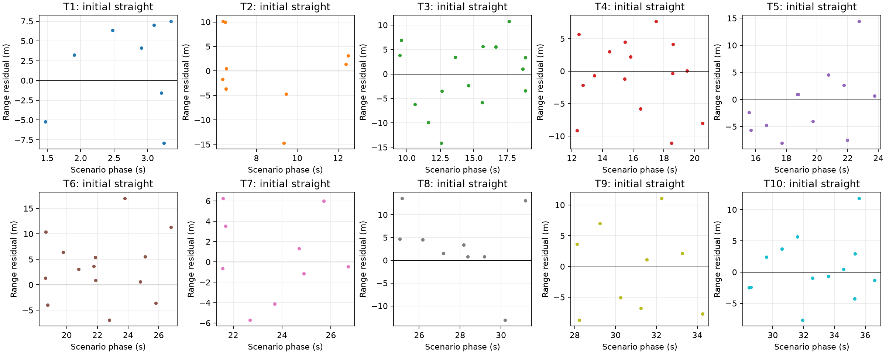

## 전체 구간 잔차와 기동 종류별 잔차

| 표적 | n | 거리 RMS/최대(m) | 방위 RMS(도) | 고각 RMS(도) | 도플러 RMS(m/s) |
| --- | --- | --- | --- | --- | --- |
| 1 | 93 | 19.539 / 44.214 | 0.00451 | 0.00306 | 1.2519 |
| 2 | 95 | 52.598 / 94.712 | 0.01546 | 0.00481 | 1.3963 |
| 3 | 162 | 803.546 / 1341.250 | 2.69955 | 0.09140 | 33.6969 |
| 4 | 170 | 42.307 / 75.782 | 0.04518 | 0.01020 | 0.8915 |
| 5 | 158 | 7.222 / 18.072 | 0.00627 | 0.01907 | 0.1009 |
| 6 | 160 | 9.044 / 24.094 | 0.01256 | 0.00844 | 0.2397 |
| 7 | 157 | 7.119 / 18.916 | 0.01028 | 0.01310 | 0.0321 |
| 8 | 133 | 6.987 / 26.227 | 0.01334 | 0.01199 | 0.0151 |
| 9 | 129 | 157.079 / 209.130 | 0.14785 | 0.01806 | 3.5093 |
| 10 | 140 | 7.314 / 20.443 | 0.02357 | 0.02212 | 0.0210 |

아래 기동 구간은 후보 모델이 계산한 기동 시작~종료 구간이다. 실제 모의기의 내부 기동 종료는
확정되지 않았고, 표적 3 등에서 **이전 기동으로 누적된 수평 오차**가 상승/하강 구간 잔차에도 포함된다.
그래서 수직 모델을 따로 볼 수 있도록 ENU 상방 위치 잔차도 함께 보고한다.

| 종류 | n | 거리 RMS/최대(m) | 방위 RMS(도) | 고각 RMS(도) | 도플러 RMS(m/s) | 상방 RMS(m) |
| --- | --- | --- | --- | --- | --- | --- |
| 1 | 148 | 106.706 / 227.713 | 0.57571 | 0.01432 | 3.7787 | 6.820 |
| 2 | 92 | 555.062 / 1219.039 | 1.44859 | 0.05656 | 15.7920 | 7.847 |
| 3 | 254 | 426.798 / 1341.250 | 1.51475 | 0.05513 | 19.5694 | 11.162 |
| 4 | 391 | 25.825 / 140.403 | 0.07288 | 0.01247 | 2.8113 | 9.874 |

후보 모델이 기동을 일찍 끝냈을 때의 오차도 숨기지 않기 위해, 추가로 각 기동의 예정 시작부터
다음 기동 시작 또는 시나리오 종료까지의 창을 계산했다. 아래 창에는 기동 뒤 직진도 포함된다.

| 종류 | n | 거리 RMS/최대(m) | 방위 RMS(도) | 고각 RMS(도) | 도플러 RMS(m/s) | 상방 RMS(m) |
| --- | --- | --- | --- | --- | --- | --- |
| 1 | 223 | 100.330 / 227.713 | 0.88942 | 0.01420 | 11.0856 | 7.603 |
| 2 | 134 | 550.672 / 1219.039 | 1.47230 | 0.05652 | 19.2722 | 9.012 |
| 3 | 375 | 415.345 / 1341.250 | 1.37316 | 0.05203 | 16.5765 | 11.159 |
| 4 | 543 | 39.666 / 214.692 | 0.13539 | 0.01345 | 3.2674 | 10.153 |

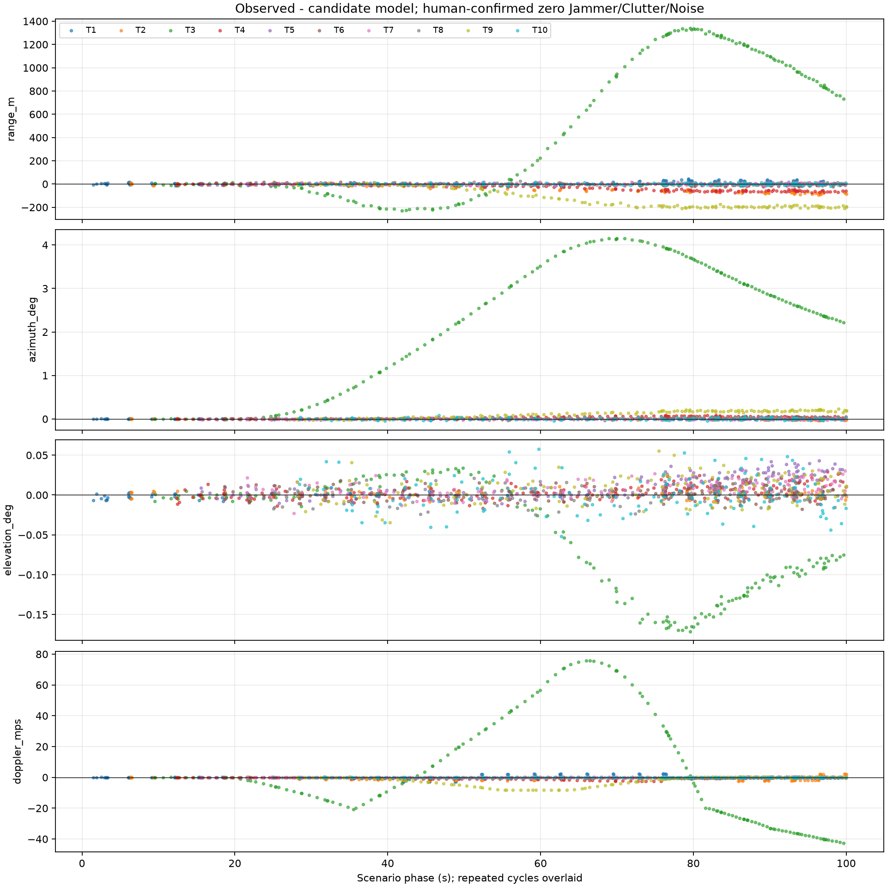

표적 3의 큰 방위·도플러 추세와 표적 9의 누적 거리 편차는 초기 단위나 공통 원점 보정만으로
해결되지 않는다. 모든 표적에 같은 물리 모델을 적용한 결과를 그대로 보고하며,
해당 표적만 별도 자유 계수로 맞추거나 관측을 정답으로 재보간해 오차를 숨기지 않았다.

## 시도한 운동 모델

수직 기동은 가속/감속 시간이 대칭인 삼각 프로파일, 선회는 ω=a/vh, a=g×필드 3을 기본 후보로 삼았다.
g=9.8을 최종 후보에 사용했지만 정확한 상수는 확정하지 않았다. 기동 끝에서는 접선 방향 운동을 유지한다.
필드 6은 초기 heading 방향의 고정 기울기 평면에 수평 궤적 변위를 투영한다.
일정한 수직 속도로 계속 내려가는 모델은 표적 1의 후반 고도와 맞지 않았다.
각 후보의 식과 한계는 [model_options.md](model_options.md)에 있다.

후보 비교는 각 연속 궤적의 5개 표본당 하나를 사용했다. 표의 XYZ RMS는
sqrt(mean((dE²+dN²+dU²)/3))이며, 최종 잔차 표는 간추리지 않은 모든 플롯을 사용했다.
같은 데이터에 여러 후보를 비교한 것으로, 표본 독립 검증을 의미하지 않는다.

| 후보 | XYZ 성분 RMS(m) | 결과/제한 |
| --- | --- | --- |
| base | 633.087 | 실제 표본에서 계산함 |
| gravity_9_8 | 633.087 | 실제 표본에서 계산함 |
| gravity_9_80665 | 633.304 | 실제 표본에서 계산함 |
| spherical_earth | 721.922 | 실제 표본에서 계산함 |
| horizontal_speed | 630.119 | 실제 표본에서 계산함 |
| flight_path_angle | 642.793 | 실제 표본에서 계산함 |
| target_relative_clock | 1106.709 | 실제 표본에서 계산함 |
| reverse_turns | 25684.111 | 실제 표본에서 계산함 |
| reverse_vertical | 708.525 | 실제 표본에서 계산함 |
| vertical_acceleration | 1224.813 | 실제 표본에서 계산함 |
| vertical_rate_10 | — | TARGET_5: overlapping maneuvers at 62s |
| load_factor | — | Coordinated level-turn load factor must exceed 1 |
| constant_turn_rate_3 | — | TARGET_9: overlapping maneuvers at 39s |
| return_initial | 11699.869 | 실제 표본에서 계산함 |
| absolute_goals | — | TARGET_9: overlapping maneuvers at 39s |

수평 속력을 유지하는 후보가 전체 XYZ RMS만 보면 조금 작지만, 표적 3의 큰 실패가 합계를 지배하고
표적 5의 XYZ RMS는 더 나빠져 최종 후보로 택하지 않았다. 현 데이터만으로 하나의 완전한 모델을 확정할 수 없다.
해결되지 않은 수평 속도 갱신식과 적분 시간 규칙은 단일 표적 실험으로 분리할 필요가 있다.

## 모의기·로거 특성과 미해결 항목

- 잡음 설정이 모두 0이어도 초기 직진 플롯에 수 m의 위치 흔들림이 남는다. 원인이 기본 측정 오차,
  양자화 또는 별도 잡음 설정인지 확인하지 못했다. 이를 전부 처리부 시각 흔들림이라고 단정하지 않는다.
- 플롯 각도는 시간에 따라 연속적으로 변하고 같은 표적에 가까운 여러 빔 표본이 있다.
  실제 빔 명령 방향과 일대일 대조하지 않았으므로 ‘정확한 실제 위치’ 또는 ‘빔 중심’ 중 하나로 확정하지 않는다.
- 수신한 빈 탐지 이벤트는 CSV에 행을 남긴다. 실제 구간에서도 7039개 빈 이벤트를 확인했다.
  모의기가 무응답한 빔까지 빠짐없이 남기는지는 별도 문제로 미확인이다.
- 추가적인 독립 궤적군은 발견하지 않았지만 표적 ID/허위 플롯의 실제 정답이 없으므로 허위 플롯 부재를 단정하지 않는다.
- 반복되는 시나리오 구간은 관측했지만 이는 프로그램을 재시작한 두 번의 독립 실험과 같지 않다.
  첫 실험 안의 반복만으로 실행 간 비트 동일성이나 운동 재현성을 확정하지 않는다.
- 모의기 버전, 최초 운동 시작을 일으킨 조작, 절대 좌표 원점과 자세 필드 순서/부호는 미해결이다.
- 현재 표적 3·9의 기동 구간을 직진 구간 수준으로 맞추지 못했다. 전체 시나리오용 검증된 정답 도구는 아직 아니다.

두 번째 수동 실험도 완료 후 별도 스냅샷으로 보존했다. 사용자가 모의기가 시나리오 종료 후 자동 반복한다고
확인했다. 따라서 한 운용 구간 안의 여러 주기를 반복 위상으로 취급하며, 이를 여러 번의 프로그램 실행으로
세지 않는다. 두 번째 운용 구간에 첫 실험의 모델·시간 옵션을 재보정하지 않고 적용한 결과는 다음과 같다.

## 두 번째 운용 구간과 실행 간 비교

분석 원본은 같은 `logs/adp_detection_20261116_211508_545.csv`의 뒤에 추가된 구간이다.
선택 시각은 **5,688,456~5,936,144ms**, 기록 시간 폭은 **247.688초**다.
운용 ON은 `2026-11-16T13:49:54.629Z`(한국 시각 22:49:54.629), OFF는 `13:54:06.459Z`다.
별도 사본 경로는 `C:\Users\user\Documents\GitHub\aesa-processor\tools\eval\data\manual_20261116_2249\detections.csv`이며
같은 디렉터리에 `processor.log`, `scenario.ini`, `metadata.json`이 있다.
원본 전체 스냅샷은 1442634 bytes이고 SHA-256은
`6f5392a61c21c8084101548805dc0536dca68ed49455b8463396473b9af8cdac`다.

이 구간은 탐지 이벤트 15864개, 빈 이벤트 13297개, 플롯 2704개다. 49개 연속 궤적 조각을 별도 검토해
`manual_run_2_mapping.json`으로 대응했다. 대응하지 못한 행과 게이트 모호성 행은 각각 0개다.
첫 실험의 시간 모델로 활성 구간 밖으로 판정된 플롯이 1개 있으며 `summary.json`에 원본 행 번호를 남겼다.
아래 모델 잔차 요약은 원래 정의대로 활성·비모호 표본만 사용하므로 2703개를 사용한다.
제외된 경계 플롯까지 포함하여 2704개 모두 잔차 CSV에는 보존했다. 경계 시각 모델도 완전히 확정되지 않았다는 뜻이다.

| 표적 | n | 초기 직진 거리 RMS(m) | 전체 거리 RMS/최대(m) | 방위 RMS(도) | 도플러 RMS(m/s) |
| --- | --- | --- | --- | --- | --- |
| 1 | 175 | 40.442 | 23.062 / 51.634 | 0.01715 | 1.4519 |
| 2 | 244 | 19.783 | 43.553 / 85.864 | 0.02658 | 0.9175 |
| 3 | 313 | 10.204 | 682.377 / 1358.764 | 2.43950 | 32.8474 |
| 4 | 328 | 13.836 | 40.531 / 80.531 | 0.02821 | 0.6678 |
| 5 | 329 | 6.903 | 7.992 / 21.599 | 0.00919 | 0.3585 |
| 6 | 343 | 8.171 | 10.072 / 36.915 | 0.00965 | 0.1591 |
| 7 | 269 | 6.724 | 6.987 / 18.273 | 0.00973 | 0.0464 |
| 8 | 248 | 6.848 | 6.681 / 18.595 | 0.01110 | 0.0188 |
| 9 | 221 | 8.405 | 143.149 / 212.118 | 0.13954 | 3.7842 |
| 10 | 233 | 6.441 | 6.974 / 21.926 | 0.02465 | 0.0191 |

두 번째 구간에서도 표적 3의 큰 방위·거리 오차와 표적 9의 누적 편차가 재현된다.
첫 실험의 위상 보정을 약 20분 뒤까지 그대로 외삽하면 빠른 표적의 초기 거리 오차도 커진다.
이를 줄이려고 두 번째 구간에서 시작 시점이나 운동 모델을 다시 최적화하지 않았다.
독립 시간 초기화·반복 주기의 정밀도는 추가 검증이 필요하다.

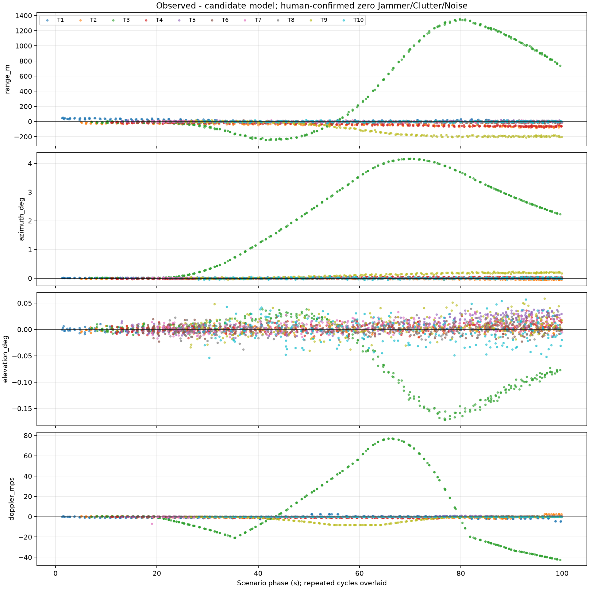

두 선택 구간의 원본 행 바이트는 동일하지 않다. 길이·수신 시각·플롯 수부터 다르며 두 구간은
첫 구간과 두 번째 구간의 기록 길이도 다르다. 이 사실만으로 같은 위상의 운동이 다르다고 결론내리지 않는다.
선택한 원본 행들의 SHA-256은 각각
`644ea663b31867930de07f52ff642f99890a724c121d2d21004f97933242ea0d`,
`5feef799ada501bf2169844d6f66c87981fecc7538c8628eb06bc91e1e1a3880`다.

공통 시나리오 위상에서는 두 번째 구간의 같은 표적을 위상별 선형 보간하여 비교했다.
보간 양쪽 표본의 간격이 1.2초 이하인 경우만 사용했고, 외삽·큰 공백 보간은 하지 않았다.
첫 실험의 위상·반복 주기를 그대로 사용했으며 오차가 작은 반복 주기를 골라 짝짓지 않았다.
비교 쌍은 3001개다. 첫 표본 하나가 여러 반복 주기의 표본과 비교될 수 있어 독립 표본 수는 아니다.
아래 차이는 두 번째 관측의 보간값−첫 번째 관측이다. 측정 흔들림과 시간 정렬·보간 오차를 모두 포함한다.

| 표적 | 비교 쌍 | 거리 차 RMS/최대(m) | 방위 차 RMS(도) | 고각 차 RMS(도) | 도플러 차 RMS(m/s) |
| --- | --- | --- | --- | --- | --- |
| 1 | 32 | 26.051 / 49.833 | 0.01753 | 0.00439 | 3.0530 |
| 2 | 110 | 16.654 / 44.117 | 0.02159 | 0.00594 | 1.9330 |
| 3 | 389 | 15.158 / 44.414 | 0.01545 | 0.00755 | 0.7356 |
| 4 | 409 | 12.149 / 36.157 | 0.01847 | 0.00932 | 0.5794 |
| 5 | 378 | 9.562 / 23.243 | 0.01072 | 0.00822 | 0.8786 |
| 6 | 381 | 9.677 / 29.292 | 0.01129 | 0.01025 | 0.1101 |
| 7 | 376 | 9.063 / 24.080 | 0.01312 | 0.01156 | 0.0806 |
| 8 | 313 | 9.218 / 28.701 | 0.01617 | 0.01458 | 0.0480 |
| 9 | 294 | 9.279 / 25.800 | 0.02090 | 0.02370 | 0.0314 |
| 10 | 319 | 9.169 / 31.618 | 0.02884 | 0.02964 | 0.0147 |

표적 3의 실행 간 거리 차 RMS는 약 15m로, 모델 대비 약 700~800m RMS보다 훨씬 작다.
이는 같은 미해결 궤적이 두 운용 구간에 나타남을 지지하지만 비트 단위 재현성을 뜻하지 않는다.
표적 1·2의 비교는 보간 가능한 표본이 상대적으로 적고 빠른 기동의 보간 오차도 포함한다.
두 번째 자료도 같은 처리부 프로세스/CSV에 추가되었으므로 **처리부까지 완전 재시작한 두 독립 실행은 확인하지 못했다.**
확인한 것은 같은 설정의 두 운용 ON/OFF 구간과 그 안의 반복 궤적이다.

## 단순 시나리오와 재개 절차

원본에서 표적 3을 복사한 `scenarios/target_3_straight.ini`, `target_3_kind_1.ini`~`target_3_kind_4.ini`를 만들었다.
표적 하나로 줄이고 필드 10을 0, 기동 시작을 10초로 바꾸었으며 각 파일은 직진 또는 한 종류의 기동만 가진다.
원본 거리·고도·속력·heading·가속도·목표값은 보존했다. 원본 ini는 수정하지 않았다.
종류 1~4 모두 사용자가 수동 실행했으며 아래에 분석했다. 직진만 있는 파일의 실행은 아직 확인하지 못했다.
현재 모은 자료로도 수직 운동 후보를 비교할 수 있으며, 좌우 선회 모델은 미해결로 남겼다.
자동 GUI 조작이나 대체 통신 시험용 모의기는 사용하지 않는다.

다음 실험도 Jammer·Clutter·Noise=0으로 약 100초 이상 실행하고, 원본 CSV·메시지 로그와 ini를 보존한다.
실행 작업 폴더에 생성되는 `logs/adp_detection_*.csv`가 실제 저장 위치이며, 실행파일의 폴더와 다를 수 있다.
디렉터리 목록의 파일 크기만으로 CSV가 비었다고 판정하지 않는다. 실제 CSV 내용을 열고
메시지 로그의 ON/OFF 시각과 선택 구간을 대조한다. 이번 종류 1 자료는 바탕화면 실행 폴더에 기록되었다.
현재 분석 사본을 덮어쓰지 말고 추가 실험 자료는 `tools/eval/data/` 아래 새 디렉터리에 보관한다.

## 단일 종류 1 추가 실험

사용자는 `scenarios/target_3_kind_1.ini`만 실행했다고 알렸고, 이번 실행에서도
**Jammer=0, Clutter=0, Noise=0**을 확인했다. 확인 답변은 스냅샷의 `confirmation.json`에 보존했다.
시나리오 자동 반복은 앞서 사용자에게 확인했다. 이번 실행은 새 처리부 CSV에 기록되었다.

실행 ini는 원본 표적 3의 거리 82km·방위 −8도·레이더 상대 고도 9000m·속력 850m/s·heading 105도를
보존하고, 표적 시작 지연을 0초로 바꾼 단일 표적이다. 유일한 기동 줄은 `10 1 2 1640.419948`이다.
따라서 후보 해석은 위상 10초에 시작하는 2g 상승, 상대 목표 500m다. 원본 10개 표적 파일은 수정하지 않았다.

| 항목 | 실제 자료 |
| --- | --- |
| CSV 원본 | `C:\Users\user\Desktop\AESA 실행파일\데이터 처리부\logs\adp_detection_20261117_001811_773.csv` |
| CSV 보존 사본 | `C:\Users\user\Documents\GitHub\aesa-processor\tools\eval\data\manual_20261117_kind_1\detections.csv` |
| CSV bytes / SHA-256 | 267527 / `b61cca5f0a3abd207eddefea3ed2404a4ff18dacbb43c7e1f89c59a7ba5d4ec9` |
| ini SHA-256 | `b4548fcb7fbef52c187a6f97dc470b176e9bff32243a202f7c72c917cd3ae4c3` |
| 운용 ON / OFF (한국 시각) | 2026-11-17 00:18:56.762 / 00:21:38.171 |
| 선택 처리부 시각 | 55957~206389ms, 폭 150.432초 |
| 이벤트 / 빈 이벤트 / 플롯 | 9624 / 9411 / 213 |
| 대응 | 관측 연속 궤적 조각 3개 모두 TARGET_1, 미대응·모호성·비활성 예측 행 각각 0개 |

같은 보존 디렉터리의 `processor.log`, `scenario.ini`, `metadata.json`에 나머지 원본·해시·선택 정보를 남겼다.
213개는 반복 주기를 포함한 플롯 수이며, 독립적인 상승 실험 213회를 뜻하지 않는다. 기동 중 표본은 한 반복 주기에서 얻었다.

물리 옵션은 기존 `manual_run_1_candidate.json`을 유지하고, 처리부 재시작을 반영하기 위해 초기 직진
19개 표본에서 **시간 원점·반복 주기만** 보정했다. 새 옵션은 `manual_kind_1_candidate.json`이다.
보정 결과 원점 약 −0.016036초, 주기 약 100.110725초, 초기 XYZ 성분 RMS 6.558682m다.
이 숫자는 보정값이며 모의기 시계의 정확도가 그 자릿수까지 확인되었다는 뜻은 아니다.
새 실험도 시간 보정에 사용한 자료와 평가 자료가 같으므로 독립 검증으로 취급하지 않는다.

수직 후보는 `g=9.8m/s²`, 총속력 일정, 수직 가속도 +19.6m/s² 후 −19.6m/s²인 대칭 삼각 속도 모델이다.
500m 상승에 걸리는 계산 시간은 약 10.102초이며, 종료 후 수직 속도 0과 목표 고도를 유지한다.
아래 구간은 후보 모델의 활성 상태로 구분했으며 실제 모의기의 정확한 종료 시점을 확인한 것은 아니다.

| 구간 | n | 거리 평균/RMS/최대(m) | 방위 RMS(도) | 고각 RMS(도) | 도플러 RMS(m/s) | 고도 잔차 평균/RMS(m) |
| --- | --- | --- | --- | --- | --- | --- |
| 초기 직진 (첫 기동 0.5초 전까지) | 19 | −1.948 / 7.818 / 17.348 | 0.00422 | 0.00406 | 0.0582 | +0.970 / 5.759 |
| 종류 1 상승 중 (위상 약 10~20.102초) | 15 | −2.587 / 6.984 / 14.754 | 0.00565 | 0.00705 | 0.6023 | +1.522 / 9.456 |
| 후보 상승 종료 후 | 179 | −5.986 / 9.320 / 27.159 | 0.00690 | 0.00806 | 0.0973 | +8.988 / 10.864 |
| 전체 | 213 | −5.387 / 9.049 / 27.159 | 0.00662 | 0.00771 | 0.1838 | +7.747 / 10.413 |

초기 직진 거리 최대 17.348m는 속력×20ms=17.000m를 조금 넘는다. 초기 거리 잔차 OLS 기울기도
−0.939m/s이며 표본이 적어 무추세를 확정하지 않는다. 완료 기준을 통과했다고 선언하지 않는다.
상승 후 관측 고도의 평균은 레이더 기준 약 9508.988m로 후보 목표 9500m보다 높다.
상승 중 도플러 잔차 최대는 1.1685m/s다. 이전 선회를 포함한 10개 표적 실험의 수백 m 거리 오차가
이 단독 상승에서는 나타나지 않아, 기존 표적 3의 큰 수평 오차를 상승 기동 하나로 설명할 수는 없다.

이산 시간 갱신이나 기동 종료 판정으로 고도 초과가 생길 가능성을 검토했으나 갱신 간격·방식은
관측으로 확정하지 못했다. 목표값을 관측 고도에 맞춰 변경하지 않았으며 기존 연속시간 후보의 편차를 그대로 남겼다.
종류 1이 상승이고 목표 단위가 ft라는 해석은 지지하지만, 정확한 가속·감속식과 종료 규칙은 미해결이다.
종류 2·3·4는 뒤에서 별도로 분석하며,
위 원본 10개 표적 실험의 종류별 수치와 혼동하지 않는다.

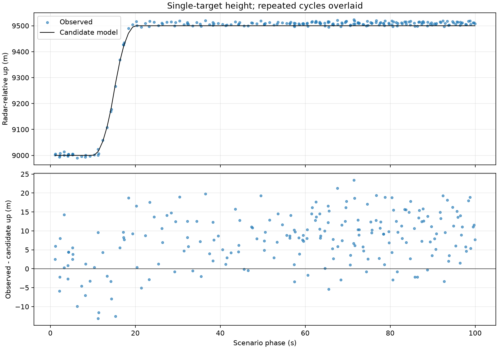

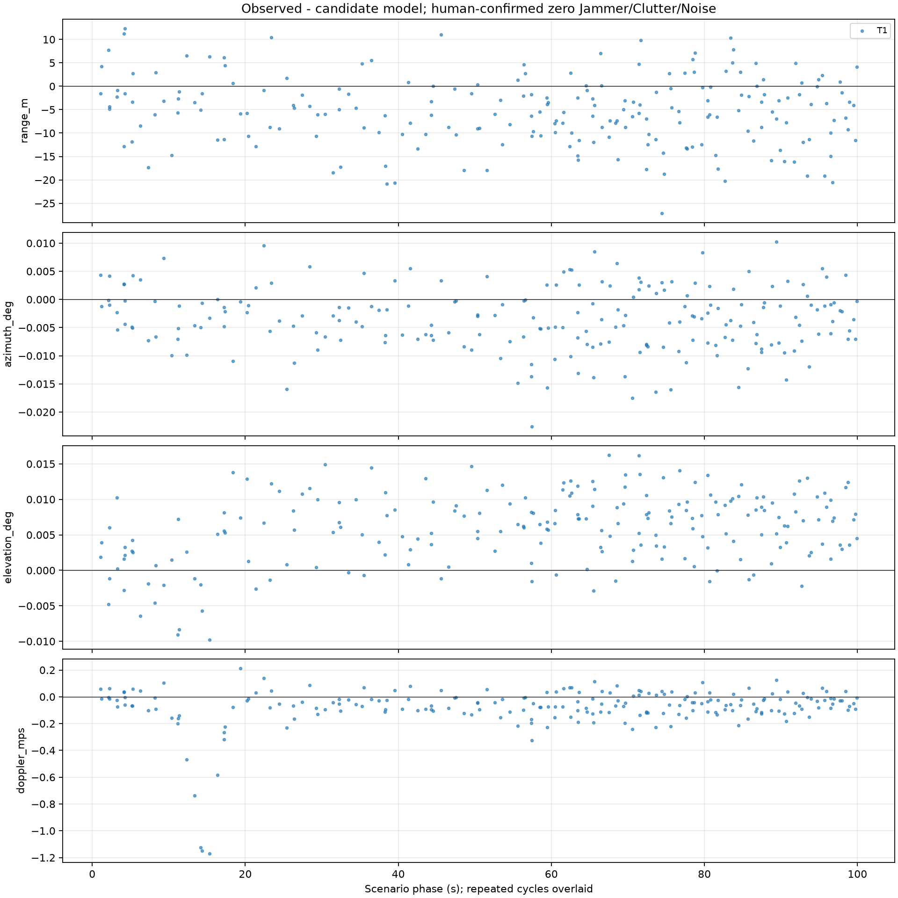

## 단일 종류 4 추가 실험

`target_3_kind_4.ini`를 같은 Jammer·Clutter·Noise=0 조건으로 110초 이상 실행하도록 안내한 뒤
사용자가 실행 완료를 알린 최신 운용 구간을 분석했다. 조건은 해당 안내와 완료 답변에 근거하며
이번 GUI 설정값을 직접 조회하거나 별도 재확인한 것은 아니다.
실행 ini는 `82 -8 9000 850 105 0 1 10 1 0 100`, 기동 줄 `10 4 3 30`이다.
후보 해석은 위상 10초에 시작하는 3g 우선회, 목표 회전각 30도다.

| 항목 | 실제 자료 |
| --- | --- |
| CSV 원본 | `C:\Users\user\Desktop\AESA 실행파일\데이터 처리부\logs\adp_detection_20261117_001811_773.csv` |
| CSV 보존 사본 | `C:\Users\user\Documents\GitHub\aesa-processor\tools\eval\data\manual_20261117_kind_4\detections.csv` |
| 전체 사본 bytes / SHA-256 | 1101553 / `9a2f7a70f6001dc1957b352e7e67aee23d8b7a4298b582961e3ddcfabef51cd0` |
| ini SHA-256 | `83e10fd36bbd09b062ee6d9be1df48e2d82fdbe8a215945b515cbcde08fd2202` |
| 운용 ON / OFF (한국 시각) | 2026-11-17 00:35:22.989 / 00:37:55.515 |
| 선택 처리부 시각 | 1032617~1183720ms, 폭 151.103초 |
| 이벤트 / 빈 이벤트 / 플롯 | 9662 / 9455 / 207 |
| 대응 | 연속 궤적 조각 2개 모두 TARGET_1, 미대응·모호성·비활성 예측 행 각각 0개 |

같은 디렉터리의 `processor.log`, `scenario.ini`, `metadata.json`에 원본 사본과 조건을 보존했다.
종류 1 실험 이후 같은 CSV에 추가된 구간이므로 독립적인 프로그램 재시작 실험은 아니다.
중간의 ON/OFF(00:24:26.763~00:29:35.046)도 전체 사본에 남아 있으나 사용한 시나리오가
명시되지 않아 이번 종류 4 분석에서는 제외했다. 이전 종류 1 스냅샷은 변경하지 않았다.

먼저 종류 1의 물리·시간 옵션을 그대로 적용하니 초기 직진 거리 RMS는 37.303m였다.
새 초기 직진 11개로 원점만 보정한 `manual_kind_4_candidate.json`에서는 11.068m로 줄었다.
표본이 반복 주기 한 개의 초기 직진에만 있어 원점과 주기를 동시에 식별할 수 없다.
따라서 주기는 기존 100.110725225초를 유지하고 원점만 약 −0.128844초로 보정했다.
기존 원점보다 약 −112.808ms 달라졌으며 이 차이를 시계 양자화나 동기화 원인으로 단정하지 않는다.
초기 XYZ 성분 RMS는 8.247526m다. 같은 자료로 시간 보정했으므로 독립 검증은 아니다.

초기 직진 거리 최대는 17.493m로 속력×20ms=17.000m를 넘는다. OLS 거리 기울기는 −0.608m/s다.
직진 완료 기준의 통과와 무추세를 확인하지 못했다.
원점 보정 후에도 기존 등속력 선회의 종료 후 거리 RMS는 2175.378m로 크다.
따라서 이 오차는 시작 시점만 조절해서 해결되지 않는다.

### 관측에서 계산한 선회 후 속도

후보 선회 종료 시각 약 25.138초보다 뒤인 위상 **30~90초**의 플롯 156개에
ENU 위치를 시간의 일차식으로 각각 회귀했다. 반복 주기는 겹쳐 계산했으므로 독립 실험 156회를 뜻하지 않는다.
이 진단은 후보 속도를 맞추는 보정에 사용하지 않았다. 결과는 `fit_velocity`로 재현한다.

| 값 | 관측 일차 회귀 | 기존 등속력 후보 | 새 회전 가속도 후보 |
| --- | --- | --- | --- |
| 동쪽 속도(m/s) | 710.829 | 601.041 | 707.159 |
| 북쪽 속도(m/s) | −648.367 | −601.041 | −644.996 |
| 상방 속도(m/s) | 0.007 | 0 | 0 |
| 속력(m/s) | 962.110 | 850.000 | 957.128 |
| heading(도) | 132.369 | 135.000 | 132.368 |

관측 일차 회귀의 위치 성분 RMS는 E/N/U 각각 7.880/8.478/6.582m다.
heading은 초기 105도에서 약 27.369도 변했으며, 입력 목표 30도와 일치하지 않는다.
속력 증가를 관측했지만 모의기 내부의 구현 오류라고 단정하지 않는다.

### 추가한 회전 가속도 후보와 남은 오차

관측 가속도 곡선이 진입 heading 105도에 수직인 등속력 선회와 다르게 나타나,
고정 ENU 기준 90도에서 가속도 방향이 회전하는 후보를 추가했다.
`turn_model="rotating_acceleration"`, `turn_acceleration_reference_deg=90`이며,
가속도 3×9.8m/s²와 각속도 a/850을 사용한다. 목표값을 조절하지 않고 기동 시간은 기존과 같은 약 15.138초로 두었다.
수식과 지원 범위는 [model_options.md](model_options.md)에 있다.
이 후보의 기준 방향은 이번 관측을 보고 선택했으므로 결과는 모델 탐색 후 잔차다.
모의기의 내부 좌표계나 보편적인 가속도 규칙을 확인했다는 뜻은 아니다.

다음은 같은 시간 원점·주기·대응을 두 후보에 적용한 결과다. 새 후보 파일은
`manual_kind_4_rotating_candidate.json`이며 기존 후보를 대체하지 않는다.

| 후보 / 구간 | n | 거리 RMS/최대(m) | 방위 RMS(도) | 고각 RMS(도) | 도플러 RMS(m/s) |
| --- | --- | --- | --- | --- | --- |
| 두 후보 공통 초기 직진 | 11 | 11.068 / 17.493 | 0.00423 | 0.00481 | 0.0588 |
| 기존 등속력 / 선회 중 | 23 | 77.207 / 159.766 | 0.31114 | 0.00799 | 13.4255 |
| 기존 등속력 / 종료 후 | 172 | 2175.378 / 6448.260 | 4.77892 | 0.31102 | 102.0680 |
| 기존 등속력 / 전체 | 207 | 1983.128 / 6448.260 | 4.35745 | 0.28353 | 93.1473 |
| 회전 가속도 / 선회 중 | 23 | 7.393 / 16.577 | 0.00606 | 0.00458 | 0.3989 |
| 회전 가속도 / 종료 후 | 172 | 47.549 / 156.378 | 0.18714 | 0.00864 | 3.3106 |
| 회전 가속도 / 전체 | 207 | 43.488 / 156.378 | 0.17060 | 0.00810 | 3.0208 |

‘선회 중/종료 후’는 후보 모델의 활성 상태 구분이다. 전체에는 초기 직진의 0.5초 안전 여유로
별도 표에서 제외된 기동 직전 플롯 1개도 포함한다.
새 후보는 선회 중에는 초기 직진과 비슷한 수준으로 맞지만 종료 후 속력이 관측보다 약 4.983m/s 작아
위상에 따른 잔차 추세가 남는다. 종료 시각·이산 갱신·속도 갱신 방식은 미해결이다.

다른 기존 후보도 전체 플롯 207개에서 비교했다. XYZ 성분 RMS는 기존 등속력 2866.764m,
하중계수 2847.074m, 고정 선회율 3도/s 3047.680m, 반대 선회 21097.080m,
선회 후 초기 방향 복귀 9089.517m, 절대 목표 16359.318m다.
회전 가속도는 기준을 진입 heading으로 두면 등속력 후보와 같고, 고정 90도 기준에서는 107.813m다.
이 XYZ 성분 RMS와 위 표의 거리 RMS는 다른 값이다. 전체 비교는 `output/kind_4/model_comparison.json`에 보존했다.

원본 첫 실험에도 고정 90도 후보를 시간·대응 재보정 없이 적용해 보았다(기존과 같은 궤적 조각당 5개 중 1개).
이 후보는 TARGET_6의 위상 74초에서 기동이 겹쳐 **무효**가 되었다.
새 결과는 `output/run_1/model_comparison_with_rotating.json`에 있으며,
무효를 0 잔차나 전체 시나리오의 검증 성공으로 취급하지 않는다.
종류 3 단독 좌선회와 종류 2 단독 하강은 뒤에서 추가 분석했다.

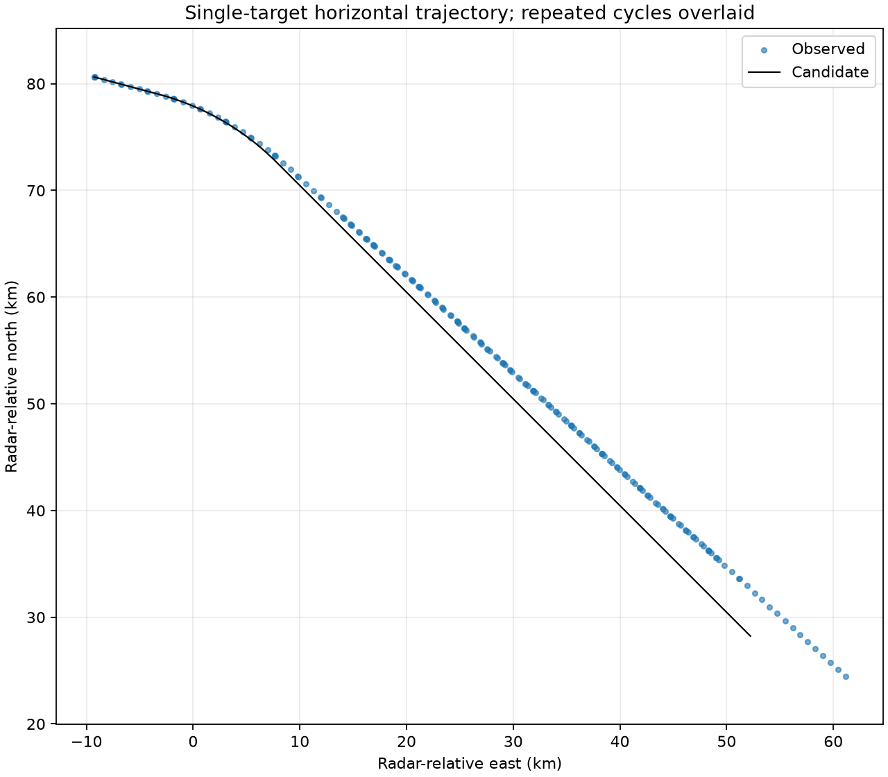

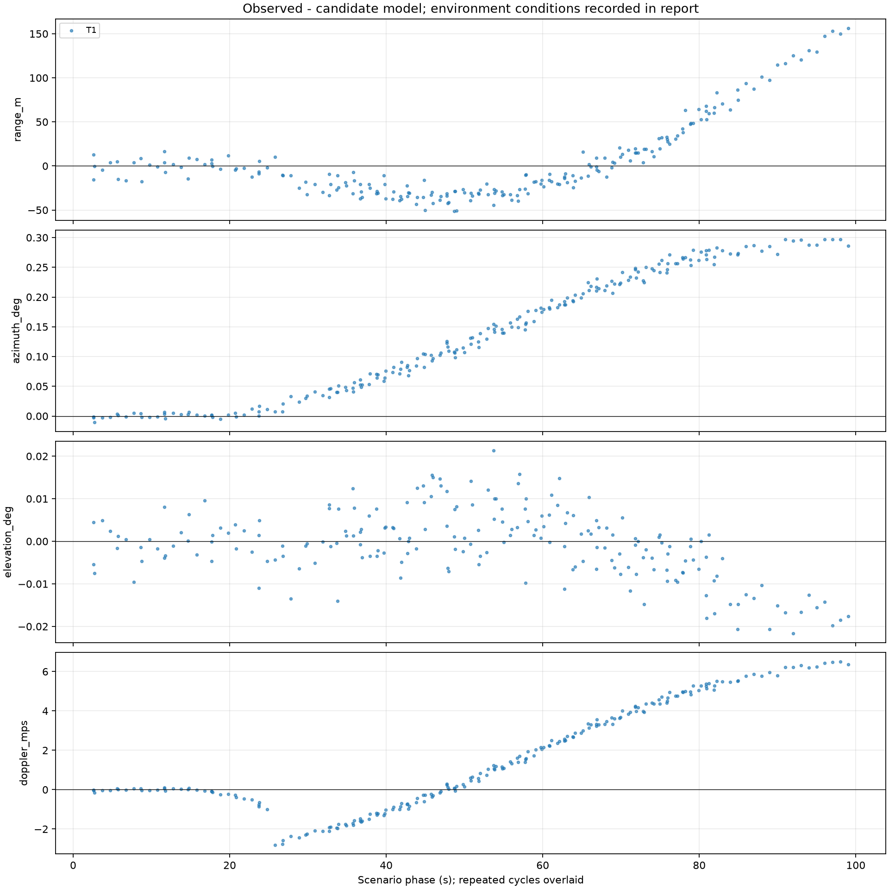

## 단일 종류 3 추가 실험

사용자가 `kind 3 측정했어`라고 알린 뒤 확보한 새 처리부 CSV를 분석했다.
앞서 안내한 `target_3_kind_3.ini`, Jammer·Clutter·Noise=0 조건으로 해석했다.
이번 GUI 설정값은 직접 조회하거나 별도 재확인하지 않았다는 한계도 메타데이터에 기록했다.
ini의 초기 상태는 앞선 단일 실험과 같으며, 기동 줄은 `10 3 3.5 50`이다.
현재 후보 해석은 위상 10초에 시작하는 3.5g 좌선회, 상대 회전 목표 50도다.

| 항목 | 실제 자료 |
| --- | --- |
| CSV 원본 | `C:\Users\user\Desktop\AESA 실행파일\데이터 처리부\logs\adp_detection_20261117_004955_840.csv` |
| CSV 보존 사본 | `C:\Users\user\Documents\GitHub\aesa-processor\tools\eval\data\manual_20261117_kind_3\detections.csv` |
| CSV bytes / SHA-256 | 435215 / `94e7d6df3874cdbee28edaca821b31126abcd1a37a5386c9de7f31252e78fdea` |
| ini SHA-256 | `ca9885cf803a35524d58d96ef6ed770c9e796df1682c4c05522d347fa32d3333` |
| 운용 ON / OFF (한국 시각) | 2026-11-17 00:50:41.666 / 00:54:49.669 |
| 선택 처리부 시각 | 50766~293811ms, 폭 243.045초 |
| 이벤트 / 빈 이벤트 / 플롯 | 15542 / 15170 / 372 |
| 대응 | 연속 궤적 조각 3개 모두 TARGET_1, 미대응·모호성·비활성 예측 행 각각 0개 |

같은 사본 디렉터리에 `processor.log`, `scenario.ini`, `metadata.json`을 보존했다.
이번에는 새 처리부 프로세스의 시작 로그와 CSV가 있다. 다만 이전과 ini가 달라
동일 조건 재현성 비교 실험으로 취급하지 않는다. 한 실행 안에서 반복된 시나리오는 독립 실행으로 세지 않는다.

기존 물리 옵션을 유지하고 초기 직진 26개 플롯으로 새 시계 원점과 주기만 보정했다.
선택된 직진은 반복 주기 번호 1·2에 있어 두 시계 변수를 식별할 수 있었다.
보정 원점은 약 0.003006초, 주기는 약 100.096670초, 초기 XYZ 성분 RMS는 6.520464m다.
이 자릿수까지 모의기의 시간 정확도를 확인했다는 뜻은 아니며, 같은 자료에서 시간을 보정한 내부 잔차다.
`manual_kind_3_candidate.json`에 이 결과를 보관했다.

초기 직진 거리 RMS는 6.135m, 최대 절댓값은 11.835m로 850m/s×20ms=17m 이내다.
이 실험의 초기 직진 거리 크기 기준은 통과한다. OLS 거리 기울기는 +0.466m/s로,
짧은 구간의 잔차에 추세가 없다고 확정하지는 않는다. 원본 전체 표적의 완료 기준도 여전히 미충족이다.

### 좌선회 종료 후 관측 속도

후보 선회 종료 시각 약 31.626초보다 뒤인 위상 **40~90초**의 관측 223개를 일차 회귀했다.
ENU 위치 회귀의 성분별 RMS는 6.902/7.134/6.367m다. 반복 위상을 겹친 표본 수이며 독립 실행 수가 아니다.
회귀 결과로 후보의 속도나 목표각을 다시 맞추지 않았다.

| 값 | 관측 일차 회귀 | 기존 등속력 후보 | 종류 4에서 가져온 회전 가속도 후보 |
| --- | --- | --- | --- |
| 동쪽 속도(m/s) | 493.791 | 696.279 | 517.406 |
| 북쪽 속도(m/s) | 414.480 | 487.540 | 431.142 |
| 상방 속도(m/s) | 0.009 | 0 | 0 |
| 속력(m/s) | 644.688 | 850.000 | 673.493 |
| heading(도) | 49.990 | 55.000 | 50.196 |

종류 4에서 속력이 증가한 것과 달리 이번 종류 3에서는 초기 850m/s보다 약 205.312m/s 감소했다.
이 비교의 초기 heading은 같지만 g값과 목표각이 다르므로 순전히 좌우 방향만 바꾼 대조 실험은 아니다.
관측 heading이 입력 목표 50도와 가까워도 이것만으로 절대 heading 목표라고 확정하지 않는다.
뒤의 절대 목표 후보도 거리·속도 잔차를 해결하지 못했다.

### 기존 후보와 회전 가속도 후보의 잔차

종류 4에서 선택한 `rotating_acceleration`·고정 기준 90도·g=9.8을 그대로 적용하고,
좌선회 부호만 기존 종류 매핑에 따랐다. 새 물리 계수를 이번 로그에 맞추지 않았다.
파일은 `manual_kind_3_rotating_candidate.json`이며, 두 후보의 시계·표적 대응은 동일하다.
다음 구간은 모의기의 실제 활성 상태가 아닌 후보의 활성 상태로 구분한다.

| 후보 / 구간 | n | 거리 RMS/최대(m) | 방위 RMS(도) | 고각 RMS(도) | 도플러 RMS(m/s) |
| --- | --- | --- | --- | --- | --- |
| 두 후보 공통 초기 직진 | 26 | 6.135 / 11.835 | 0.00390 | 0.00547 | 0.0534 |
| 기존 등속력 / 선회 중 | 64 | 255.216 / 722.696 | 0.64844 | 0.01920 | 48.8761 |
| 기존 등속력 / 종료 후 | 282 | 6797.739 / 11733.998 | 4.27268 | 0.28147 | 164.1818 |
| 기존 등속력 / 전체 | 372 | 5919.528 / 11733.998 | 3.72980 | 0.24520 | 144.3784 |
| 회전 가속도 / 선회 중 | 64 | 30.334 / 98.361 | 0.02775 | 0.00474 | 7.1447 |
| 회전 가속도 / 종료 후 | 282 | 1052.529 / 1802.084 | 0.40324 | 0.04632 | 25.1927 |
| 회전 가속도 / 전체 | 372 | 916.492 / 1802.084 | 0.35128 | 0.04040 | 22.1338 |

회전 가속도 후보는 기존보다 잔차를 줄이지만 초기 직진 수준으로 맞지 않는다.
종료 후 예측 속력은 관측보다 약 28.805m/s 크고, 거리 잔차 기울기는 −25.133m/s로 뚜렷한 누적 오차가 있다.
따라서 종류 4에서 만든 규칙은 종류 3까지 설명하는 공통 정답 모델로 검증되지 않았다.

전체 372개에서 다른 기존 옵션도 비교했다. XYZ 성분 RMS는 등속력 5356.184m,
하중계수 5360.754m, 고정 선회율 3도/s 5427.448m, 반대 선회 30736.689m,
선회 후 초기 방향 복귀 14767.883m, 절대 목표 5067.038m,
회전 가속도 고정 90도 652.255m다. 이 값은 위 표의 거리 RMS와 다르다.
선회율·속력 갱신·종료 규칙 중 어느 부분이 실제 방식과 다른지는 확정하지 못했다.
기존 물리 옵션과 새 가설을 모두 미확정으로 유지하며 관측 최종 속도를 강제로 정답 모델에 넣지 않았다.

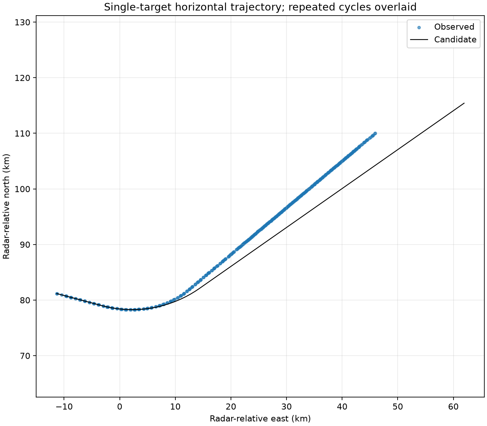

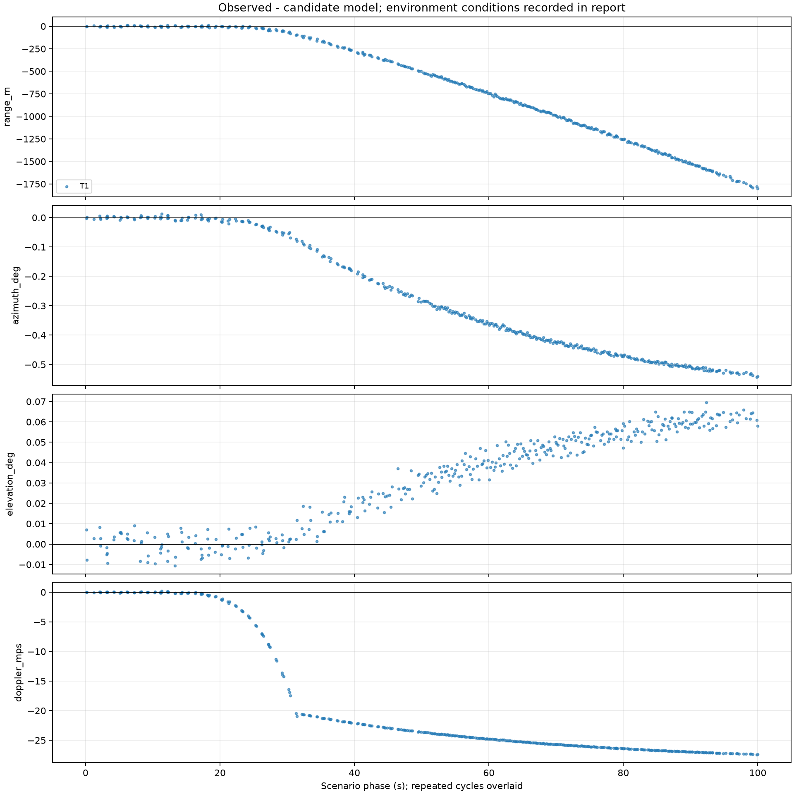

## 단일 종류 2 추가 실험과 수직 갱신 후보

사용자가 `kind 2 실행했어`라고 알린 뒤 새 운용 구간을 보존했다.
안내한 `target_3_kind_2.ini`, Jammer·Clutter·Noise=0 조건을 따른 실험으로 해석했으며,
이번 GUI 설정값을 직접 조회하거나 별도로 재확인한 것은 아니다.
초기 상태는 앞선 단일 실험과 같고, 유일한 기동 줄은 `10 2 2 984.2519685`다.
기존 해석은 위상 10초에 시작하는 2g 하강, 상대 목표 약 300m(ft 변환)다.

| 항목 | 실제 자료 |
| --- | --- |
| CSV 원본 | `C:\Users\user\Desktop\AESA 실행파일\데이터 처리부\logs\adp_detection_20261117_004955_840.csv` |
| CSV 보존 사본 | `C:\Users\user\Documents\GitHub\aesa-processor\tools\eval\data\manual_20261117_kind_2\detections.csv` |
| 전체 사본 bytes / SHA-256 | 815586 / `437be6daae47d7b282e1313d67740240cba42052d7f9681fb4825db2ac1705b6` |
| ini SHA-256 | `39acb2ce03017ca36fab95e600a2b4945372334ef9551bedf432faf7acf74829` |
| 운용 ON / OFF (한국 시각) | 2026-11-17 01:04:09.321 / 01:07:42.892 |
| 선택 처리부 시각 | 857784~1067047ms, 폭 209.263초 |
| 이벤트 / 빈 이벤트 / 플롯 | 13367 / 13061 / 306 |
| 대응 | 연속 궤적 조각 3개 모두 TARGET_1, 미대응·모호성·비활성 예측 행 각각 0개 |

같은 보존 디렉터리에 메시지 로그와 ini·메타데이터도 있다. 종류 3과 같은 처리부 프로세스의
CSV에 추가된 ON/OFF 구간이며, 종류 3 스냅샷은 변경하지 않았다.
초기 직진 26개(반복 주기 9·10)로 시간만 보정했다. 원점 약 −0.008509초, 주기 약 100.099873초,
XYZ 성분 RMS 7.933143m다. 같은 자료로 보정했으므로 독립 시간 검증은 아니다.
기존 수직 물리 옵션은 `manual_kind_1_candidate.json`에서 유지했고 결과는 `manual_kind_2_candidate.json`에 있다.
초기 직진 거리 최대 16.374m는 속력×20ms=17m 이내지만, OLS 기울기 +0.283m/s로 무추세를 확정하지 않는다.

### 종료 후에도 이어지는 하강

기존 연속 삼각 가속도 후보는 위상 약 17.825초에 고도 8700m·vz=0으로 끝난다.
실제 위상 30~90초의 관측 190개를 일차 회귀하면 속도는
E/N/U = 821.017/−220.030/**−1.954m/s**, 속력 약 849.992m/s다.
회귀 위치 성분 RMS는 6.597/7.004/7.077m다.
관측은 목표 부근에서 수평 비행으로 바뀌지 않고 이후에도 내려간다.
연속 후보의 종료 후 고도 잔차 기울기는 −1.945m/s, RMS는 105.172m다.

2g×9.8m/s²×0.1초는 1.96m/s로, 관측의 잔여 하강 속도와 가깝다.
이를 근거로 `vertical_model="discrete_triangular"`, `vertical_update_step_s=0.1` 후보를 추가했다.
기동 시작을 포함하여 일정 간격마다 가속도를 속도에 적용하고, 공칭 T/2 전후에 부호를 바꾼다.
종료 시 고도와 수직 속도를 강제로 목표값으로 덮어쓰지 않는다. 수식과 정확한 갱신 순서는
[model_options.md](model_options.md)에 있다. 이 후보는 이번 관측을 보고 선택했으므로 독립적인 모델 확정이 아니다.

기존 시간 원점·주기·대응을 재보정하지 않고 적용한 결과다.
각 ‘중/후’는 공칭 기동 시간에 따른 후보 구분이며, 모의기의 내부 상태를 직접 확인한 값은 아니다.

| 후보 / 구간 | n | 거리 RMS/최대(m) | 방위 RMS(도) | 고각 RMS(도) | 도플러 RMS(m/s) | 고도 평균/RMS(m) |
| --- | --- | --- | --- | --- | --- | --- |
| 공통 초기 직진 | 26 | 8.465 / 16.374 | 0.00461 | 0.00614 | 0.0636 | −0.080 / 8.415 |
| 연속 후보 / 하강 중 | 23 | 6.828 / 17.412 | 0.00486 | 0.00677 | 0.5646 | −4.802 / 9.342 |
| 연속 후보 / 종료 후 | 257 | 14.651 / 34.290 | 0.00471 | 0.07134 | 0.1987 | −94.439 / 105.172 |
| 연속 후보 / 전체 | 306 | 13.780 / 34.290 | 0.00471 | 0.06543 | 0.2397 | −79.684 / 96.449 |
| 0.1초 후보 / 하강 중 | 23 | 6.682 / 17.865 | 0.00481 | 0.00502 | 0.4342 | −0.182 / 6.845 |
| 0.1초 후보 / 종료 후 | 257 | 7.122 / 20.780 | 0.00472 | 0.00494 | 0.0663 | +0.624 / 6.894 |
| 0.1초 후보 / 전체 | 306 | 7.214 / 20.780 | 0.00472 | 0.00506 | 0.1349 | +0.504 / 7.033 |

새 후보의 종료 후 고도 잔차 기울기는 +0.01486m/s, 거리 기울기는 −0.00055m/s다.
새 모델은 −1.96m/s의 잔여 vz를 유지하여 누적 하강을 설명한다. 공칭 T에 고도는 8700m로
고정되지 않으며, 예를 들어 시나리오 위상 30초의 계산 고도는 8662.684m다.
정확한 갱신 주기·기동 경계의 위상·가속도 적용 순서는 여전히 미확정이다.

### 같은 규칙을 이전 상승과 원본 시나리오에 적용

0.1초 규칙을 새로 고른 뒤 이전 종류 1에 물리 계수·시간·목표값을 다시 맞추지 않고 적용했다.
500m 상승 후보는 공칭 종료 후 고도 9509.796m, vz≈0을 예측하여 이전의 약 9m 고도 초과를 설명한다.
종류 1 종료 후 고도 평균/RMS는 연속 후보 +8.988/10.864m에서 이산 후보 −0.808/6.155m로 줄었다.
상승 중 고도 RMS도 9.456→8.637m로 줄었다. 반면 상승 중 도플러 RMS는 0.6023→0.7009m/s,
전체 거리 RMS는 9.049→9.633m로 악화했다. 이 개선을 모든 관측량의 검증 성공으로 해석하지 않는다.
해당 파일은 `manual_kind_1_discrete_candidate.json`이며 종류 2는 `manual_kind_2_discrete_candidate.json`이다.

종류 2 전체 플롯의 옵션 비교에서 XYZ 성분 RMS는 연속 삼각 55.971m, 이산 삼각 6.947m,
가속 유지 2810.134m, 일정 하강률 10m/s 115.760m, 반대 수직 기동 372.432m다.
이 값은 위 표의 거리 RMS와 다르다. 결과는 `output/kind_2/model_comparison.json`에 있다.

원본 첫 실험에도 같은 이산 수직 옵션을 적용했다(시간·대응 유지, 기존과 같은 조각당 5개 중 1개).
TARGET_5의 XYZ 성분 RMS는 12.633→8.118m로 줄었지만,
전체는 633.087→633.175m로 개선되지 않았다. 큰 선회 오차는 해결되지 않았다.
비교 결과는 `output/run_1/model_comparison_with_discrete_vertical.json`에 보존했다.
따라서 이산 수직 갱신은 단일 상승·하강의 특징을 함께 설명하는 유력 후보이며, 전체 시나리오용 확정 정답은 아니다.

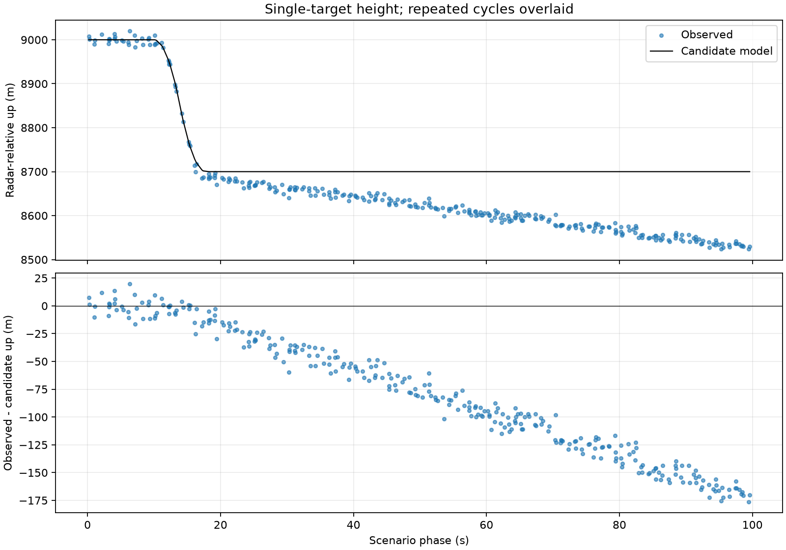

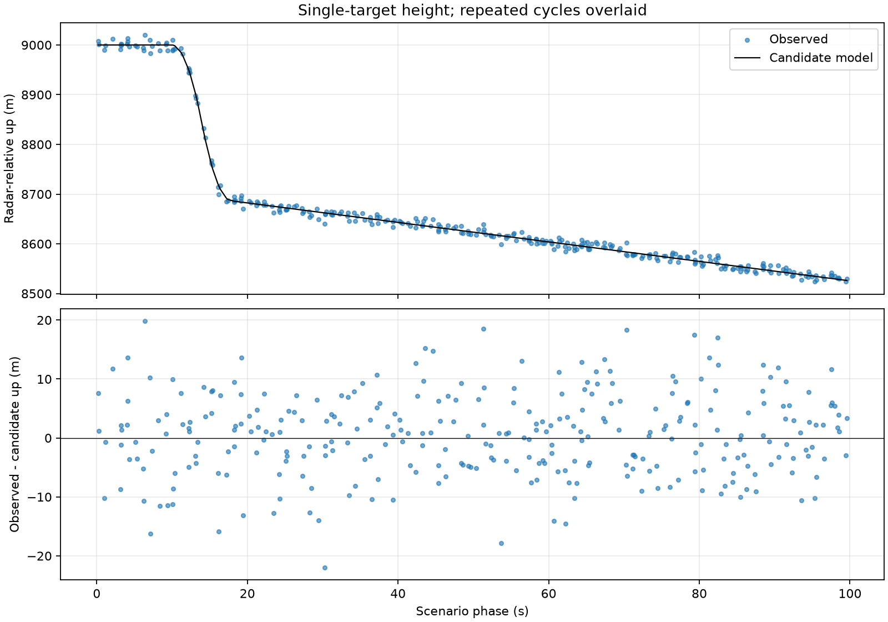

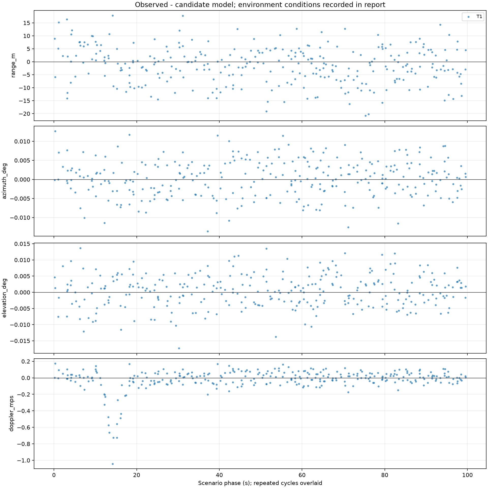

## 단일 종류별 검증 상태

아래는 종류별로 보관한 후보의 요약이며 하나의 통합 모델이 모든 실험을 통과했다는 뜻은 아니다.
모든 종류의 실제 수동 실행 자료와 기동 중 잔차는 확보했다.

| 종류 | 보관 후보 | 기동 중 n / 거리 RMS(m) | 종료 후 n / 거리 RMS(m) | 남은 문제 |
| --- | --- | --- | --- | --- |
| 1 상승 | 0.1초 이산 수직 | 15 / 7.183 | 179 / 9.981 | 거리 편향·기동 중 도플러, 초기 최대 17.348m로 17m 한계 초과 |
| 2 하강 | 0.1초 이산 수직 | 23 / 6.682 | 257 / 7.122 | 갱신·종료 규칙 미확정, 기동 중 도플러 잔차 |
| 3 좌선회 | 고정 90도 회전 가속도 | 64 / 30.334 | 282 / 1052.529 | 큰 속력·방향·누적 오차, 공통 선회 규칙 미확정 |
| 4 우선회 | 고정 90도 회전 가속도 | 23 / 7.393 | 172 / 47.549 | 종료 후 속력 차이와 잔차 추세, 초기 최대 17.493m로 17m 한계 초과 |

위 표는 GUI 추가 실험 전 후보의 상태다. 아래의 순간 속력 결합 후보에서는 종류 3·4의 종료 후
거리 RMS가 각각 7.320/7.868m로 줄었다. 전체 공통 초기화 규칙과 완료 기준은 여전히 미확정이다.

전체 완료 기준은 여전히 미충족이다. 원본 초기 직진에서 표적 5~10의 거리 한계 초과와 무추세 미확인,
선회 모델의 큰 오차, 동일 조건으로 완전히 재시작한 두 실행의 재현성 미확인이 남아 있다.
이번 종류 2 실행으로 단독 종류 1~4의 자료 확보는 마쳤으며 추가 수동 실행을 전제로 수치를 채우지 않았다.

## GUI 추가 실험: 초기 heading 90도 좌우 선회

사용자가 이미 실행 중인 모의기·전시기의 직접 제어를 요청한 뒤 에이전트가 GUI로 수행했다.
사용자가 알려 준 시작 순서는 **전시기 Start → 모의기 모의 시작**이다.
전시기 Start만 눌렀던 앞선 짧은 시도는 `data/gui_heading90_right_attempt_1/`에 별도로 보존하고
모델 검증에서 제외했다. 이 짧은 시도로 창의 전경/배경 의존성을 추론하지 않는다.

`scenarios/heading_90_right_3g_30.ini`, `heading_90_left_3g_30.ini`는 기존 단일 종류 4 파일의
초기 heading을 105→90도로 바꾼 복사본이다. 좌측 파일은 종류만 4→3으로 바꿨다.
둘 다 850m/s, 위상 10초, 3g, 목표 30도다. 각 구간 중 ini를 다시 불러오지 않았다.
환경 화면에서 Jammer·Clutter 목록이 비어 있고 Noise 값 0,
**고정 노이즈 레벨 체크 꺼짐**을 확인했다. 이를 측정 오차가 없는 조건이라고 해석하지 않는다.

CSV 원본은 `C:\Users\user\Desktop\AESA 실행파일\데이터 처리부\logs\adp_detection_20261117_004955_840.csv`다.
메시지 로그도 같은 폴더의 `adp_20261117_004955_837.log`다. 계속 추가되는 원본에서 별도 사본을 보존했다.

| 항목 | 우선회 | 좌선회 |
| --- | --- | --- |
| Git 제외 보존 폴더 | `tools/eval/data/gui_heading90_right/` | `tools/eval/data/gui_heading90_left/` |
| 선택 처리부 시각(ms) | 2463262~2606828 | 2742074~2894526 |
| 기록 폭(s) | 143.566 | 152.452 |
| 이벤트 / 빈 이벤트 / 플롯 | 9189 / 8900 / 289 | 9780 / 9547 / 233 |
| 연속 조각 / 모호·미대응·비활성 행 | 3 / 모두 0 | 2 / 모두 0 |
| CSV 사본 bytes | 1098551 | 1384161 |
| CSV SHA-256 | `e155e6282ec22b613205752be3340d4cfd5070b69803a3f2fa0fc8a482db7aa2` | `9db0c3ec7961debd1e2bff77dda428e7115f7b0a7fc656b8fcc5645896949244` |
| ini SHA-256 | `7c21a382ea1b1bc1f3e7371ca8a92d5be7963709c9459674aed47015b02fdbce` | `62728efb6eaf25a2db8e34f763b3d3dd8afc83504ae87e46eb9820a6c4ee0a05` |

관측의 연속성, 단일 표적의 초기 위치와 반복 경계를 확인해 모두 TARGET_1에 대응시켰다.
대응은 `gui_heading90_right_mapping.json`, `gui_heading90_left_mapping.json`에 보관했다.
미대응 0개가 허위 플롯의 부재를 증명하지는 않는다. 반복 주기들을 독립 실행으로 세지 않았다.

초기 직진만으로 시계를 보정하고 물리 단위는 기존 후보에서 유지했다.
우측은 15표본·2주기로 원점 0.010646069초, 주기 100.098470246초, XYZ 성분 RMS 5.705660m다.
좌측은 14표본·1주기뿐이라 같은 주기를 유지하고 원점만 0.018482148초로 보정했다(XYZ 6.344725m).
초기 거리 최대 잔차는 우 15.718m, 좌 12.185m로 17m 이내지만, 짧은 구간의 OLS 기울기
−1.354/+0.656m/s를 무추세로 단정하지 않는다. 최초 CSV 행을 운동 원점으로 사용하지 않았다.

### 순간 속력과 결합한 회전 후보

가속도 방향의 기준각 ψ와 속도 방향을 따로 두고, 우측을 양으로 하는 부호 있는 a에 대해
`dvE/dt = a cos ψ`, `dvN/dt = −a sin ψ`, `dψ/dt = a / hypot(vE,vN)`을 적분한다.
공칭 시간은 진입 속력×목표각/가속도로 계산하고 0.1초 단위로 올림한다.
`turn_model="speed_coupled_rotation"`, `turn_duration_step_s=0.1` 옵션을 추가했다.
단독 105도 실험에서는 첫 ψ=90도를 사용했다. 기존 시계·단위·표적 대응을 다시 맞추지 않았다.
이 식은 관측에서 선택한 가설이며 외부 프로그램 소스로 확인한 구현이 아니다.

같은 식의 105도 좌우 선회 종료 후 계산 속력은 우 962.104, 좌 644.639m/s이며,
관측 위치의 회귀 속력은 각각 962.110/644.688m/s다.
90도 실험의 관측은 우 850.025m/s·heading 120.121도, 좌 849.985m/s·heading 59.873도다.
새 후보는 양쪽 850m/s·heading 약 120.122/59.878도를 예측해 목표각의 작은 초과도 설명한다.

| 실험 / 새 후보의 구간 | n | 거리 RMS/최대(m) | 방위 RMS(도) | 고각 RMS(도) | 도플러 RMS(m/s) |
| --- | --- | --- | --- | --- | --- |
| 90도·우 / 선회 중 | 37 | 8.790 / 17.554 | 0.00499 | 0.00440 | 0.0768 |
| 90도·우 / 종료 후 | 236 | 6.827 / 25.424 | 0.00556 | 0.00515 | 0.0796 |
| 90도·좌 / 선회 중 | 21 | 8.726 / 20.159 | 0.00497 | 0.00477 | 0.1433 |
| 90도·좌 / 종료 후 | 197 | 6.631 / 18.913 | 0.00408 | 0.00359 | 0.0409 |
| 기존 105도·우 / 선회 중 | 23 | 7.195 / 16.577 | 0.00427 | 0.00460 | 0.0612 |
| 기존 105도·우 / 종료 후 | 172 | 7.868 / 25.469 | 0.00887 | 0.00596 | 0.1415 |
| 기존 105도·좌 / 선회 중 | 64 | 7.217 / 17.373 | 0.00582 | 0.00460 | 0.0889 |
| 기존 105도·좌 / 종료 후 | 282 | 7.320 / 22.172 | 0.00398 | 0.00371 | 0.0250 |

90도 종료 후 거리 RMS는 기존 원호 후보의 우 81.407/좌 47.722m에서 6.827/6.631m로 감소했다.
105도에서는 이전 고정 회전율 후보의 우 47.549/좌 1052.529m에서 7.868/7.320m로 감소했다.
종료 후 거리의 OLS 기울기는 표 순서대로 +0.00050/+0.03217/−0.03579/+0.03033m/s다.
모든 조건에서 무추세와 20ms 이내 최대 오차를 충족했다고 선언하지 않는다.
초기 직진은 그대로이며, 기존 105도 우측의 최대 17.493m는 17m를 넘는다.

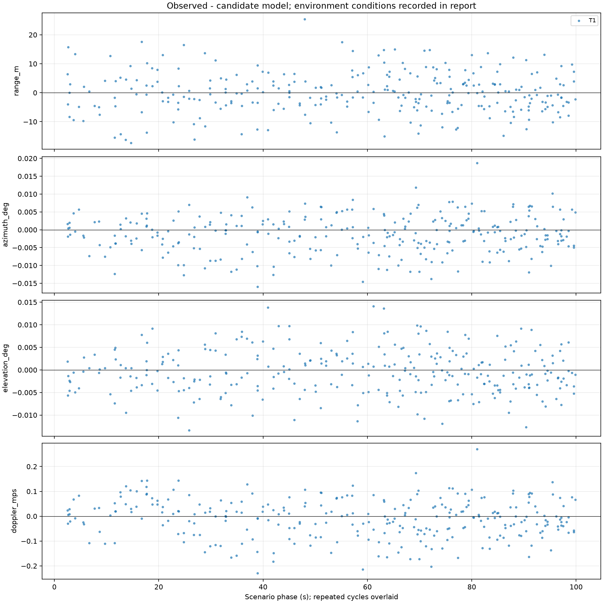

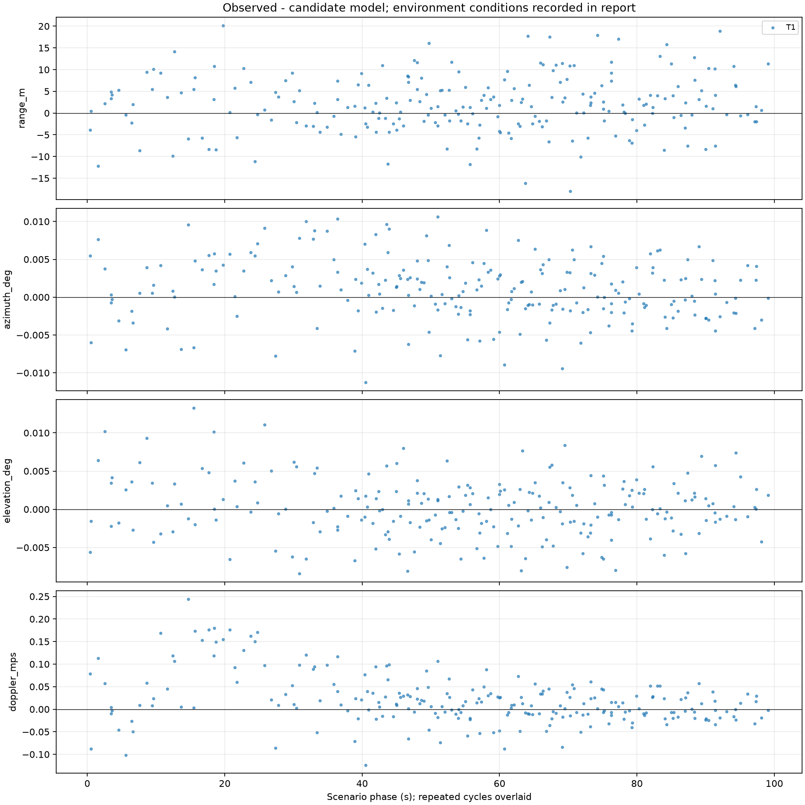

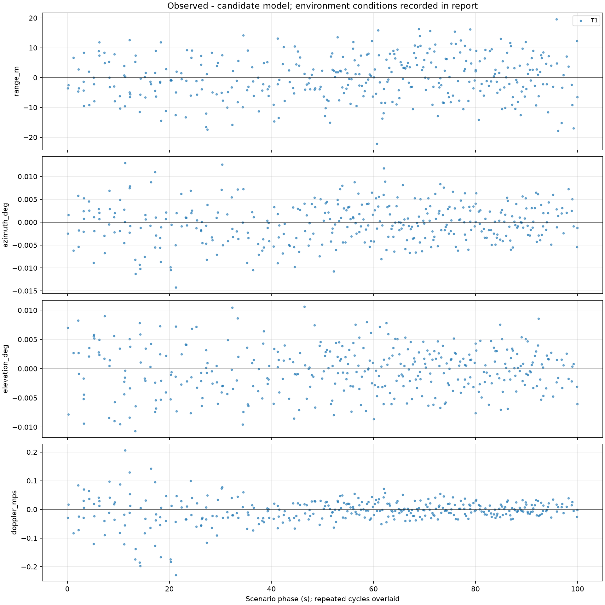

### 연속 기동으로 이어지는 방향과 미해결 초기화

원본에서도 시간·대응을 유지해 비교했다. 선회 사이의 ψ를 유지하고 다음 공칭 시간에는 TARGET의
초기 속력을 쓰는 후보를 `turn_reference_mode="persistent"`, `turn_duration_speed="initial"`로 두었다.
수직은 앞서 비교한 0.1초 삼각 갱신을 병용했다. 첫 ψ를 진입 heading으로 두면 표적 3·9를 제외한
8개 표적의 거리 RMS가 약 6~8m가 된다. 첫 ψ=90도는 표적 3·9를 설명하지만 나머지에서 실패한다.

| 표적 | 진입 heading 초기화 / 거리 RMS(m) | 고정 90도 초기화 / 거리 RMS(m) |
| --- | --- | --- |
| 1 | 6.432 | 72058.921 |
| 2 | 7.009 | 16872.830 |
| 3 | 855.289 | 8.326 |
| 4 | 6.330 | 14211.294 |
| 5 | 7.284 | 3241.233 |
| 6 | 7.071 | 3507.827 |
| 7 | 7.076 | 276.704 |
| 8 | 6.942 | 1259.542 |
| 9 | 157.697 | 7.320 |
| 10 | 7.357 | 136.208 |

전체 1397플롯에서 계산한 표다. 후보별 대응·시간 재보정은 없다. 옵션 파일은
`manual_run_1_coupled_entry_candidate.json`, `manual_run_1_coupled_persistent_candidate.json`,
출력 폴더는 `output/run_1_coupled_entry/`, `output/run_1_coupled_persistent/`다.
표적마다 작은 값만 고른 결과를 하나의 공통 모델 검증 성공으로 취급하지 않는다.
매 선회마다 ψ를 90도로 되돌리는 규칙, 진입 속력으로 공칭 시간을 계산하는 규칙,
진입 heading을 90도 단위로 반올림하는 규칙도 전체 일치에 실패했다. 조각당 5개 중 1개로 비교한
진단 결과는 `output/run_1/coupled_continuation_comparison.json`, `coupled_cardinal_comparison.json`에 있다.
기동 중첩으로 무효인 후보와 `overlap_policy="replace"`로 따로 계산한 후보를 구분해 기록했다.

### 고정 Noise=0 체크 비교

같은 우선회 ini에서 고정 노이즈 레벨을 **체크**, 값 0으로 환경 설정을 전송하고 완료 메시지를 확인했다.
화면의 값 오른쪽에는 `GHz`가 표시된다. 이 입력이 측정 좌표의 오차 크기를 직접 지정하는지는 확인하지 못했다.
선택 구간은 **3502904~3679565ms**, 176.661초, 이벤트 11305개·빈 이벤트 11054개·플롯 251개다.
3개 연속 조각 모두 TARGET_1이며 모호·미대응·비활성 행은 0개다.
원본 경로는 위와 같고 `tools/eval/data/gui_heading90_right_fixed_noise_0/`에 보존했다.
CSV 사본은 1713215 bytes, SHA-256
`60a022bd1fbefb7d826dafa245e6e834afe05b850c2652d9ec7c310d8a7e9c7e`다.
ini는 첫 우선회와 바이트·해시가 같다. 운용 구간 중 다시 불러오지 않았다.

첫 우선회의 새 후보 옵션·시계·물리 계수를 그대로 사용했다. 전체 거리 RMS는 체크 전 7.144m,
체크 후 6.416m이고 고도 RMS는 6.463/6.544m다. 체크 후 선회 중 44개 표본의 거리 RMS/최대는
6.604/15.733m, 방위·고각·도플러 RMS는 0.00637도/0.00512도/0.1947m/s다.
종료 후 183개는 거리 RMS/최대 6.488/18.750m, 방위·고각·도플러 RMS
0.00791도/0.00481도/0.1137m/s다. 초기 직진 22개는 RMS 5.542m, 최대 10.375m다.
**체크+0에서도 수 m의 산포가 남으므로 이 설정이 측정 오차를 완전히 제거한다고 확인할 수 없다.**
표본 시각과 개수가 달라 두 RMS의 차이만으로 체크의 효과를 확정하지 않는다.
전시기·모의기·처리부를 완전히 재시작한 동일 조건 2회 실험으로 취급하지 않는다.

전체 공통 ψ 초기화, 저속 표적의 산포에 의한 20ms 기준 초과, 완전 재시작 2회의 재현성이 남아 있다.
계산 결과의 `unverified_hypothesis` 상태를 유지한다.

사용자는 고속·비정상적인 기동에서는 처리부가 추적을 유지하지 못할 수 있다고 설명했다.
추적 실패는 추적 빔의 누락·관측 간격 증가와 표본 부족에 영향을 줄 수 있다.
여기서 계산한 잔차는 처리부 추정 트랙이 아니라 `DetectionEvent.plots`의 측정값과 ini 후보의 차이다.
분석의 연속 조각 번호도 처리부 track ID가 아니라 관측 위치·시간만으로 묶은 번호다.
관측이 성기면 이 대응도 잘못될 수 있으므로 큰 잔차는 운동식·시각·대응의 문제를 함께 점검해야 한다.
추적 실패 자체가 이미 수신된 플롯 좌표와 계산값의 편차를 직접 설명한다고 단정하지 않는다.
정답 모델을 확인할 때는 단일 표적·충분한 관측 구간을 우선 사용하고, 어려운 기동에서 추적이 끊긴
현상은 정답 모델 검증과 구분한다. 이번 과제에서는 추적 성공률이나 추적 오차를 계산하지 않았다.

추가 실험 종료 후 고정 노이즈 체크를 원래의 꺼짐·값 0으로 되돌려 전송했고,
실험 전에 불러와 있던 `target_3_kind_2.ini`도 다시 전송했다. 프로그램은 켜 둔 채
전시기 Stop·모의기 모의 종료 상태로 남겼다. 세 추가 실험의 원본 해시와 원본 다운로드 ini의 불변을 확인했다.

## 재현과 구현 확인

실행 명령은 [README.md](README.md)에 있다. `intake`로 원본 바이트·해시를 보존하고,
`analyze`로 연속 궤적과 잔차 CSV/JSON/그림을 생성하며, `fit_straight`로 단위 후보를 비교하고,
`compare_models`로 기동 후보를 비교한다. 분석 수치는 실제 스냅샷과 출력 `summary.json`에서 계산했다.

- Python 단위 테스트 44개 통과. CR 처리, 이벤트 완전성, 교차 궤적 연결/모호성,
  시간 보정, 반복·생존 구간, 고정 기울기 평면, 기동, 도플러, CLI와 원본 보존 등을 시험했다.
- 시간만 보정하는 옵션 추가 후 원본 초기 직진 후보 탐색도 다시 실행해 기존 최선 RMS 6.434535m와
  위상 원점·주기가 유지되는 것을 확인했다. 단독 상승 그림과 잔차도 실제 사본에서 재생성했다.
- 회전 가속도 후보는 진입 heading 기준에서 기존 좌/우 원호와 일치하는지,
  고정 기준의 위치·속도·종료 후 진행 및 거리 미분과 도플러가 일치하는지 시험했다.
- 단독 종류 4는 실제 원본에서 두 후보의 잔차·그림·관측 속도 회귀와 전체 후보 비교를 실행했다.
- 단독 종류 3도 두 후보의 전체 372개 잔차·그림·관측 속도 회귀·옵션 비교를 실제 사본에서 실행했다.
  공통 라이브러리의 운동식은 이번 종류 3에 맞춰 변경하지 않았다.
- 이산 수직 모델은 가속·감속 횟수가 다른 경우의 잔여 vz·목표 초과, 균형 잡힌 경우의 수평 복귀,
  수치 적분 간격을 바꾼 결과의 일치, 도플러와 거리 미분의 일치를 시험했다.
- 종류 2의 연속/이산 후보와 이전 종류 1의 이산 후보를 실제 전체 플롯에서 비교했고,
  원본 첫 실험에도 시간·대응 재보정 없이 후보 비교를 실행했다.
- 순간 속력 결합 모델은 회전 좌표의 독립 해석식, 좌우 원호, 0.1초 종료 올림, 적분 간격 수렴,
  위치 미분·도플러, 두 기동 사이의 기준각 유지와 반대 기동 후 속도 복귀를 시험했다.
- GUI 추가 실험 3건과 기존 단일 선회 2건, 원본 10표적의 두 초기화 후보를 실제 사본에서 계산했다.
- `python -m compileall -q tools/eval`: 성공.
- 처리부 C++ 빌드·C++ 테스트는 수행하지 않았다. 처리부 소스 변경은 없다.
- 기존 원본 및 종류 1~4 실험은 사용자가 수동으로 실행했다. 이후 GUI 추가 실험은 사용자의 직접 제어 요청에 따라 에이전트가 조작했다.
- 기존 코드·테스트의 컨벤션 위반을 지적할 사항은 제한된 열람에서 확인하지 못했다. 전체 감사는 하지 않았다.
